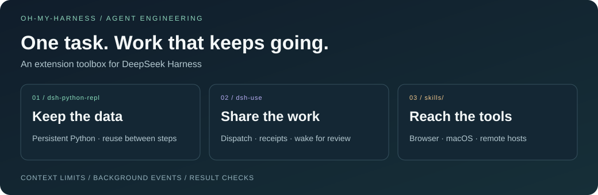
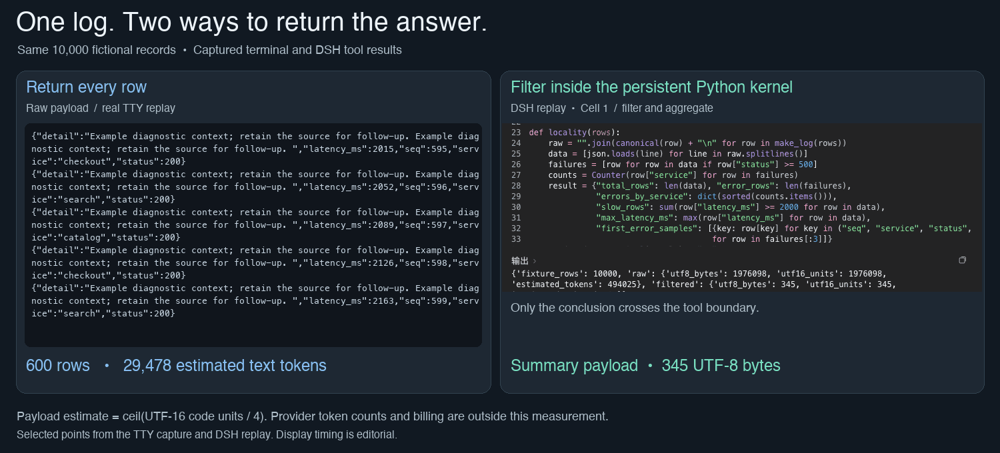

[中文](README.md) | English

# oh-my-harness

**A toolbox for agents that keep working.**

Persistent Python, session coordination, and computer tools for [DeepSeek Harness](https://github.com/deepseek-ai/deepseek-harness) (DSH). Pick the parts you need, or explore how an agent keeps intermediate results, hands off tasks, waits for events, and comes back to check the outcome.

[Get started](docs/getting-started.en.md) · [All components](docs/components.en.md) · [Architecture](docs/architecture.en.md) · [Documentation](docs/README.en.md)

<picture>
  <source media="(max-width: 600px)" srcset="docs/assets/overview-mobile.en.svg">
  
</picture>

An independently maintained **collection of DSH extensions and a harness workshop**. A harness connects a model to tools and a working process. DSH provides the host; this repository explores and implements extensions. Primarily supported on macOS. Not affiliated with DeepSeek.

## Where to start

| What you want to do | Start here | What changes |
| --- | --- | --- |
| Analyze many files, logs, or tool results | [Persistent Python](dsh-python-repl/README.en.md) | Keep data in variables, reuse it in the next step, and display the evidence needed. |
| Share a long task across sessions | [Session control](dsh-use/README.en.md) | Dispatch with receipts, notify the lead when work settles, then review the result. |
| Let an agent operate a computer | [Browser](skills/browser-use/README.en.md) · [Desktop](skills/computer-use/README.en.md) · [SSH](skills/remote-host/README.en.md) | Cra and Chrome share page and debugging APIs. Desktop actions target a window and SSH actions target a host. |

Find context helpers, background events, output guards, and UI extensions in the [component catalog](docs/components.en.md). Choose components individually; each README owns its installation steps.

## See one example

The same fictional log, returned two ways: display all the text on the left; aggregate it in persistent Python on the right, return the conclusion, and reuse the variable in the next step.

Excerpts from recorded results. The text-size measurements use fixed fictional input and exclude model bills and overall speed. [Reproduce it](benchmarks/README.en.md) · [Dispatch and review demo](dsh-use/README.en.md#see-it-work) · [Archived browser demo](docs/browser-use.en.md#two-tabs)

## What is worth exploring

- DSH can already call tools from code. What made Prime Agent’s Python kernel worth integrating? [Follow a result across two cells](docs/design/python-data-locality.en.md).
- Two tabs or windows can have the same title. How does an agent act on the one its user picked? [Selecting a tab in Cra or Chrome](docs/design/browser-control.en.md) · [Why build a Mac desktop tool?](docs/design/desktop-control.en.md)
- **Make handoffs observable.** Track send receipts, execution state, and acceptance separately; let background notifications handle waiting. [Design](docs/design/controller-worker.en.md)
- **Give long work a stopping point.** Budget context, retain the user's exact words during compaction, and stop runaway output. [Design](docs/design/three-generations-of-compaction.en.md)

The [architecture guide](docs/architecture.en.md) separates the roles of DSH, the upstream Prime kernel, and this repository. [Using dotfiles](docs/dotfiles.en.md) explains how reusable code stays separate from personal configuration.

## Before installing

Start with [one plugin](docs/getting-started.en.md). Keep the full source checkout, build it, and link it into your own DSH profile. The maintainer's dotfiles are not required.

The Python kernel runs trusted code with filesystem, network, and process access. **It is not a sandbox.** Browser, desktop, and SSH operations use real account permissions; a timeout does not undo an action. Installing the Python bundle replaces DSH's TypeScript execution backend and disables workflow entries that depend on it. Read the [security boundaries](SECURITY.en.md).

## Help maintain it

[Contributing](CONTRIBUTING.en.md) · [Maintenance roadmap](docs/maintenance.en.md) · [Changelog](CHANGELOG.en.md) · [Issues](https://github.com/gwsbhqt/oh-my-harness/issues) · [Private security reports](SECURITY.en.md)

MIT licensed. The Python execution and snapshot core comes from [Prime Agent](dsh-python-repl/vendor/PROVENANCE.md), with its [license](dsh-python-repl/vendor/prime/LICENSE) preserved. This repository provides DSH integration, permission and lifecycle handling, and tool and skill integration. Thanks to DSH and the upstream authors.
