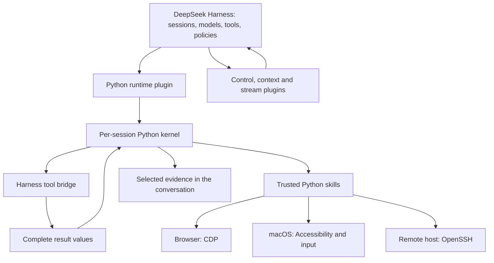

[中文](README.en.md) | English

# oh-my-harness

**Add-ons for the AI assistant in DeepSeek Harness: let it write programs to get work done, split work with other assistants, operate the browser and the Mac, and keep working for hours without drowning in its own chat history.**

[](https://github.com/gwsbhqt/oh-my-harness/actions)
[](LICENSE)

## What this is

[DeepSeek Harness](https://github.com/deepseek-ai/deepseek-harness) (DSH) is an AI assistant app that runs on your Mac: you open a session, say what you need, and it calls tools to do the work.

This repository is **not a standalone app**. It is a set of components that add abilities to DSH; install only the ones you need. An independent community project, **not affiliated with or endorsed by DeepSeek**.

## Components

| Kind | Component | In one line |
| --- | --- | --- |
| **Core** | [dsh-python-repl](dsh-python-repl/README.en.md) | Lets the assistant do its work in Python. Large data stays in the program; only the conclusion goes into the chat. [Details below](#core-1-dsh-python-repl-let-the-assistant-write-programs) |
| **Core** | [dsh-use](dsh-use/README.en.md) | Remote-controls a running DSH so one assistant can lead several others. [Details below](#core-2-dsh-use-one-assistant-leads-several-others) |
| Operate the computer | [browser-use](skills/browser-use/README.en.md) · [computer-use](skills/computer-use/README.en.md) · [remote-host](skills/remote-host/README.en.md) | Operate web pages, Mac desktop apps, and another machine. |
| Supporting plugins | [dsh-monitor](dsh-monitor/README.en.md) · [dsh-output-guard](dsh-output-guard/README.en.md) · [dsh-compaction-bound](dsh-compaction-bound/README.en.md) · [dsh-message-tidy](dsh-message-tidy/README.en.md) · [dsh-image-cap](dsh-image-cap/README.en.md) · [dsh-history-cap](dsh-history-cap/README.en.md) | Wake on background events, stop runaway output, and keep long chats from overflowing. [Details below](#other-components) |

There are two kinds: **plugins** load into DSH itself (the 8 root folders that start with `dsh-`); **tools** are separate programs the assistant can call, under `skills/`, and also work on their own from a terminal. Each component's README has its real demo; click a name to see it.

## Core 1: dsh-python-repl, let the assistant write programs

**Without it.** The assistant calls one tool per step, and whatever the tool returns goes into the chat in full. Ask it which services fail in a 10,000-line log, and it reads the whole log into the chat and scans it line by line. Expensive, slow, and easy to miss things.

**With it.** The assistant writes a short piece of Python instead:

1. It calls the file-reading tool from the program. The log stays in the program, not in the chat.
2. The program filters errors, counts them by service, and picks a few samples.
3. Only a few lines of conclusion go into the chat: which services fail, how many times, and where the samples are.

If the next step needs the same data, it uses the variable already in the program instead of reading the log again.

**How much it saves.** The same 10,000 fictional log records and the same question, answered both ways:

Both paths read the same **10,000 fictional JSONL records** to count errors by service and identify samples.

| Returned payload | UTF-16 code units | Estimated tokens |
| --- | ---: | ---: |
| Entire log | 1,976,098 | 494,025 |
| Local Python aggregation and identified samples | 345 | 87 |

Estimates use **ceil(UTF-16 code units / 4)** on returned payload text, not a model tokenizer. See the [method, exclusions, and compaction results](benchmarks/README.en.md) and [recorded output](benchmarks/results.json).

**It also:**

- **Calls many tools from one program**, including DSH's own file and command tools and the three computer-operation tools below.
- **Keeps data between steps and across restarts.** A variable computed in one step is used directly in the next. After DSH restarts, savable data comes back and anything lost is reported to the assistant. [Session lifecycle source](dsh-python-repl/src/session.ts)
- **Shows tool instructions on demand.** Frequently used tools get full instructions; the rest get a one-line summary until needed, so each turn sends less boilerplate. [Prompt assembly source](dsh-python-repl/src/index.ts)
- **Shows only the start and end of long output.** When a step prints thousands of lines, the chat shows the beginning and end; the full content stays in the program for later work.

**How is this different from DSH's built-in code mode and Prime Agent?** DSH's built-in code mode has the model write TypeScript, and by default everything is cleared after each run. Prime Agent is a standalone AI assistant built around an always-open Python environment, but it cannot be installed into DSH. dsh-python-repl brings Prime's Python kernel into DSH: variables survive between steps and across restarts, and DSH still owns the conversation and permissions. [Full comparison](dsh-python-repl/README.en.md#how-this-differs-from-dshs-built-in-code-mode-and-prime-agent)

[README and demo](dsh-python-repl/README.en.md) · [Guide](docs/dsh-python-repl.en.md) · [Design article: keep data in the program](docs/design/python-data-locality.en.md)

## Core 2: dsh-use, one assistant leads several others

**Without it.** DSH sessions can only be opened and messaged by hand in the window. Outside scripts and other AI assistants cannot reach the running DSH. A long task needs one expensive model watching it from start to finish.

**With it.** An example, step by step:

1. A session on an expensive model acts as the **lead**. It writes the task as a brief, opens another session on a cheaper model as the **worker**, and sends the brief.
2. The lead then stops. It does not keep asking "done yet?".
3. The worker does the job. Only when it is really done does dsh-use wake the lead with a notice. "Really done" is judged by actual state: no running turn, no queued message, no background job, stable for a short while; not by whether the reply says "finished" ([completion source](dsh-use/src/service.ts)).
4. The lead wakes up and checks the result itself. If it passes, the lead sends the next batch; if not, it says exactly what is wrong and sends it back.
5. If DSH restarts midway, interrupted sessions resume on their own, and messages swallowed while queued are put back ([recovery source](dsh-use/src/cli/core.ts)).

**It also:**

- **Offers three ways to control the same DSH:** a command line, Python, and MCP (a common protocol for connecting tools). It listens only on this Mac and only for the same system account.
- **Keeps a receipt for every message sent.** A wait that times out means "not finished yet", so nobody resends a message that was already delivered.
- **Picks models by remaining quota.** Two tiers, main and light; models close to their limit move to the back, and it never switches tiers silently.
- **Works across machines.** It controls DSH on another Mac over SSH without opening a network port.

[README and demo](dsh-use/README.en.md) · [Guide](docs/dsh-use.en.md) · [Design article: lead and worker](docs/design/controller-worker.en.md)

## Other components

Click a name to open that component's own README with setup, configuration, limits, and its demo. "Guide" links to a task-oriented walkthrough.

**Work alongside the two core components**

| Component | What it does | Use it when |
| --- | --- | --- |
| [dsh-monitor](dsh-monitor/README.en.md) | Watches a long-running command and wakes the assistant with each new line it prints. | You wait on a build, a log, or a file, and don't want the assistant to keep checking. [Guide](docs/dsh-monitor.en.md) |
| [dsh-output-guard](dsh-output-guard/README.en.md) | Stops the model when it starts repeating itself, printing blank lines, or ending without an answer; can retry once automatically. | Long runs sometimes produce runaway output. [Guide](docs/dsh-output-guard.en.md) |

**Operate the computer**

| Component | What it does | Use it when |
| --- | --- | --- |
| [browser-use](skills/browser-use/README.en.md) | Operates chosen pages in Chrome or Arc: read, click, type, screenshot. Each task gets its own window and re-reads the page after acting. | The assistant should do something on a website for you. [Guide](docs/browser-use.en.md) |
| [computer-use](skills/computer-use/README.en.md) | Operates ordinary Mac app windows: read the interface, click, type, screenshot. Keystrokes go only to the chosen window. | The target is a desktop app, not a web page. [Guide](docs/computer-use.en.md) |
| [remote-host](skills/remote-host/README.en.md) | Runs commands, copies files, and manages background jobs on another machine over SSH. If the other side lacks a tool, it fails instead of quietly running locally. | The work happens on another computer or server. [Guide](docs/remote-host.en.md) |

The three tools share a small library, [`skills/_shared`](skills/_shared/README.en.md), that handles connections and target machines. It is not used on its own.

**Keep long sessions manageable**

| Component | What it does | Use it when |
| --- | --- | --- |
| [dsh-compaction-bound](dsh-compaction-bound/README.en.md) | When the chat history is compacted, your own messages are copied word for word instead of being paraphrased by the model, and the result has a fixed size limit. | A session needs to keep going for hours. [Guide](docs/dsh-compaction-bound.en.md) |
| [dsh-message-tidy](dsh-message-tidy/README.en.md) | Cleans up notices DSH adds to the chat: marks them as system notices rather than your words, drops duplicates, gives background jobs readable names, and sends only the changed part of an updated instruction file. | System notices pile up and clutter the chat. [Guide](docs/dsh-message-tidy.en.md) |
| [dsh-image-cap](dsh-image-cap/README.en.md) | Limits the size and number of images sent to the model. | Screenshot-heavy tasks spend too much context on images. [Guide](docs/dsh-image-cap.en.md) |
| [dsh-history-cap](dsh-history-cap/README.en.md) | Loads a long session's history in pages when you open it. Affects only the app window, not what the model sees. | Long sessions open slowly in the app. [Guide](docs/dsh-history-cap.en.md) |

**Also in the repository:** [design articles](docs/design/python-data-locality.en.md) explain why each part works the way it does; [benchmarks](benchmarks/README.en.md) reproduce the numbers on this page; `tooling/` holds the shared plugin build tools; [llms.txt](llms.txt) is an entry point for AI assistants.


## How they work together

```text
You ──task──▶ the assistant in DSH
                  │
                  ├─ writes Python to do the work (dsh-python-repl)
                  │     ├─ calls DSH's built-in tools
                  │     ├─ operates web pages, desktop apps, remote machines (3 tools)
                  │     └─ keeps large data in the program, returns only conclusions
                  │
                  ├─ hands tasks to other sessions and waits for them (dsh-use)
                  ├─ wakes up when a background event arrives (dsh-monitor)
                  └─ stays within limits however long the chat gets (4 context plugins + dsh-output-guard)
```

## Why this exists

| Without it | With it |
| --- | --- |
| A tool returns a huge log and all of it lands in the chat: expensive and easy to misread. | The data stays in Python; only the computed conclusion comes back. |
| An expensive model watches every step of a long job. | The expensive model leads and reviews; a cheaper model does the work. |
| Outside scripts cannot reach a running DSH. | A command line, Python, and MCP (a common protocol for connecting tools) all control the same DSH. |
| Compaction lets the model paraphrase, or change, what you said. | Your words are copied as written, plus an index with a size limit. |
| Several assistants fight over one browser tab or desktop window. | Each task sticks to its own window and never clicks into another's. |
| A command may quietly run locally when the remote machine lacks a tool. | The remote side is checked first; a missing tool is an error. |

## More engineering highlights

- **Your words skip the model.** Compaction copies your messages into an appendix by source. When space runs out, older ones become a "which turn said what" index, and the oldest ranges merge first. [Appendix implementation](dsh-compaction-bound/src/summary.ts).
- **Every action has a definite target.** Browser tasks get their own windows. Desktop actions remember the exact app and window, and keystrokes go only there. [Browser targets](skills/browser-use/src/browser_use/engine.py) · [Desktop routing](skills/computer-use/bin/computer-use.swift).
- **Uncertain results are reported as uncertain.** A remote machine missing a tool is rejected before running. A browser action whose reply is lost is reported as "outcome unknown" and is not clicked again. [Remote preflight](skills/_shared/agentkit/remote/target.py) · [Browser RPC](skills/browser-use/src/browser_use/client.py).

## Start with one plugin

Use DeepSeek Harness on macOS with a tool-capable model. Follow the [kernel README](dsh-python-repl/README.en.md) for Node.js, pnpm, uv, and Python requirements.

### 1. Build from source

Plugin builds use adjacent `tooling/`; keep the checkout intact.

```sh
git clone https://github.com/gwsbhqt/oh-my-harness.git
cd oh-my-harness
pnpm --dir dsh-python-repl install --frozen-lockfile
pnpm --dir dsh-python-repl run check
```

### 2. Link the bundle into your DSH profile

Merge these entries into the profile manifest. Set the checkout link **relative to that profile**.

```json
{
  "dependencies": {
    "dsh-python-repl": "link:../../src/oh-my-harness/dsh-python-repl"
  },
  "dsh": {
    "profile": { "bundles": ["dsh-python-repl"] }
  }
}
```

Install in that profile with DSH's pnpm, run startup checks, then restart DSH. Follow the [bundle setup and removal guide](dsh-python-repl/README.en.md).

### 3. Verify a useful result

From the checkout, create the exact fictional fixture and reference answer:

```sh
python3 benchmarks/run.py --export-log example-log.jsonl --export-conclusion example-answer.json
```

Open a DSH session in the checkout and ask:

> Read the generated example log into a Python variable. Keep the complete data in the kernel. Compute the same counts and identified samples as the benchmark, and compare the result with the exported reference answer. Return the comparison and necessary evidence, not the entire log. In the next cell, reuse the retained data without reading it again.

Check the comparison and reuse the same variable in the next cell.

## Add the control surfaces you need

The 3 computer-operating tools live under `skills/`. Install dsh-python-repl first, then register that folder as a trusted skill directory in its configuration so the assistant can call them. Each tool's README has the steps; see [Components](#components).

## What DSH provides and what this adds



| Responsibility | Host supplies | This repository adds |
| --- | --- | --- |
| Agent execution | Sessions, models, tools, jobs, policies | Extensions, not a new model service. |
| Code | TypeScript programmatic tool calling | Python backend, bridge, skill loading, snapshots. |
| Compaction | Triggers, basic engine, checkpoints | Retention defaults, bounded instructions, exact-user-text appendix. |
| Control | Internal typed services | Local endpoint, CLI/Python/MCP, receipts, settled observation. |
| Devices | Execution and tool-policy context | Skills using CDP, Accessibility, and SSH permissions. |
| Output/events | Jobs, rendering, spill storage, delivery | Display budgets, stream checks, producer delivery. |

## Compare by the problem you have

Choose by the workflow you need. Scope below comes from each project's documentation.

| Option and source | Published scope | When it may be a better fit |
| --- | --- | --- |
| [browser-use][browser-use] | Browser agent with model-written Python, a persistent REPL, and CDP. | Browser-focused agent/library or hosted browsers without DSH. |
| [browser-harness][browser-harness] | Real-browser CDP access for existing agents, through CLI/skill or MCP. | Add browser access to your current coding agent. |
| [cua][cua] | Desktop CLI, MCP, SDKs, and virtual-desktop offerings. | Its desktop/VM ecosystem or platform matrix fits your target. |
| [OmO][omo] | Coding-agent system with multi-model orchestration and memory workflow. | Adopt its integrated workflow for your coding agent. |
| Direct MCP tools: [integration examples][browser-harness] · [protocol architecture][mcp] | Client/server interface for tools and other capabilities. | Existing clients and servers supply your required tools, state, and permissions. |

Python plus CDP is shared ground. This collection adds DSH runtime control and context helpers. `dsh-use` also exposes MCP; each client decides how results enter its transcript.

## Design choices worth inspecting

- [Python data locality](docs/design/python-data-locality.en.md).
- [Compaction generations](docs/design/three-generations-of-compaction.en.md).
- [Controller and worker](docs/design/controller-worker.en.md).
- [Task boundaries](docs/design/task-isolation.en.md).
- [Output boundaries](docs/design/output-guard.en.md).

## Security and limits

**The Python kernel is trusted code, not a sandbox.** It can access files, networks, and processes independently of the Harness tool bridge. Configured skills execute Python during import. Host tool approval does not revoke Python's operating-system access.

Browser attachment may use an authenticated profile. Task windows share that profile's account state; debugging access must not be exposed to an untrusted network. Desktop control requires macOS permissions and can affect real windows. Targeted input reduces interference but cannot eliminate focus races. SSH uses the destination account's real permissions, not a simulated remote environment. A timeout does not undo an external action.

The control endpoint is local to the system account; do not proxy it publicly. Its read-only mode and namespace restrictions cover that interface, not arbitrary Python.

The Python bundle replaces TypeScript PTC and disables dependent workflow entries. Startup may download dependencies. Snapshots restore supported values, not live connections or processes. A short display does not prove source completeness. Contract tests check interfaces; live sites and desktops need separate verification.

Read [SECURITY.md](SECURITY.en.md) for private vulnerability reporting and [CONTRIBUTING.md](CONTRIBUTING.en.md) for verification. Keep credentials, authenticated screenshots, and real session logs out of issues.

## When something goes wrong

First find which step actually failed: was the plugin built, did the assistant find the tool, is the target page or window still there, was the message really delivered? Confirm you have complete data before counting anything. Each component's README explains recovery.

Use the [bug form](.github/ISSUE_TEMPLATE/bug.yml) with fictional inputs and actual check results; report private findings through [security reporting](SECURITY.en.md).

## Contributing, license, and attribution

For small, evidenced changes, start with [CONTRIBUTING.md](CONTRIBUTING.en.md), the [Code of Conduct](CODE_OF_CONDUCT.en.md), and [agent guidance](AGENTS.md). Contributors own their generated changes and actions.

Code is [MIT licensed](LICENSE); third-party notices remain, including the [Prime REPL license](dsh-python-repl/vendor/prime/LICENSE) and [provenance](dsh-python-repl/vendor/PROVENANCE.md). Thanks to DeepSeek Harness and upstream authors for the host engine and Python orchestration foundations.

[browser-use]: https://github.com/browser-use/browser-use
[browser-harness]: https://github.com/browser-use/browser-harness
[cua]: https://github.com/trycua/cua
[omo]: https://github.com/code-yeongyu/oh-my-opencode
[mcp]: https://modelcontextprotocol.io/docs/learn/architecture