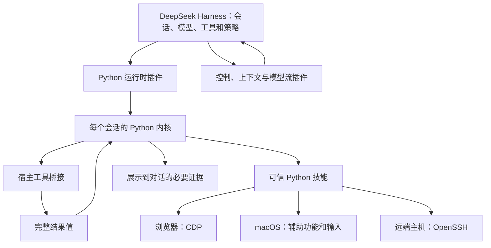

中文 | [English](README.en.md)

# oh-my-harness

**给 DeepSeek Harness 里的 AI 助手装上的一组扩展：让它能写程序连续做事、带着别的助手分工、动手操作浏览器和电脑，并且长时间工作也不被聊天记录撑爆。**

[](https://github.com/gwsbhqt/oh-my-harness/actions)
[](LICENSE)

## 先说清楚：这是什么

[DeepSeek Harness](https://github.com/deepseek-ai/deepseek-harness)（下文简称 DSH）是一个在 Mac 上运行的 AI 助手应用：你开一个会话，跟它说要做什么，它调用各种工具去做。

本仓库**不是一个独立软件**，而是给 DSH 加能力的一组部件，可以只装需要的那几个。本项目由社区独立维护，**并非 DeepSeek 官方产品，也不隶属或获得 DeepSeek 背书**。

## 由哪几块组成

| 类别 | 部件 | 一句话 |
| --- | --- | --- |
| **核心** | [dsh-python-repl](dsh-python-repl/README.md) | 让助手写 Python 来做事，大块数据留在程序里，只把结论放进对话。[详见下文](#核心一dsh-python-repl让助手写程序做事) |
| **核心** | [dsh-use](dsh-use/README.md) | 从外面遥控正在运行的 DSH，让一个助手当主控，带着几个助手分头干活。[详见下文](#核心二dsh-use让一个助手带着几个助手干活) |
| 操作电脑 | [browser-use](skills/browser-use/README.md) · [computer-use](skills/computer-use/README.md) · [remote-host](skills/remote-host/README.md) | 操作网页、Mac 桌面应用、另一台机器。 |
| 配套插件 | [dsh-monitor](dsh-monitor/README.md) · [dsh-guard](dsh-guard/README.md) · [dsh-compaction-bound](dsh-compaction-bound/README.md) · [dsh-message-tidy](dsh-message-tidy/README.md) · [dsh-image-cap](dsh-image-cap/README.md) · [dsh-history-cap](dsh-history-cap/README.md) | 后台事件叫醒、拦住失控输出、让模型自己收口、让长对话不被撑爆。[详见下文](#其他部件) |

部件分两种：**插件**装进 DSH 本身，仓库根目录下 `dsh-` 开头的 8 个文件夹都是；**工具**是助手可以调用的独立程序，放在 `skills/` 下，也能在终端里单独用。每个部件的说明里都放了它的真实演示，点部件名就能看到。

## 核心一：dsh-python-repl，让助手写程序做事

**没有它时。** 助手每做一步都要调一次工具，工具返回什么，就整段塞进对话。比如让它查一份 1 万条的日志里哪些服务报错：它会把整份日志读进对话，再自己一行行看。又贵又慢，还容易看漏。

**有了它。** 助手改成写一小段 Python：

1. 在程序里调用读文件的工具，日志拿到手后留在程序里，不进对话；
2. 在程序里筛出报错、按服务计数、挑几条样本；
3. 只把「哪几个服务报错、各多少条、样本在第几行」这几行结论放进对话。

下一步还要用这份数据，直接用程序里的变量，不用再读一遍。

**省了多少。** 同一份 1 万条虚构日志、同一个问题，两种回法的对比：

两条路径都读取同一份 **10,000 条虚构 JSONL 记录**，统计服务错误并找到样本。

| 返回内容 | UTF-16 代码单元 | 估算 token |
| --- | ---: | ---: |
| 完整日志 | 1,976,098 | 494,025 |
| Python 本地聚合及可定位样本 | 345 | 87 |

估算口径是对返回文本计算 **ceil(UTF-16 代码单元 / 4)**，不是模型分词器的精确计数。完整的[方法、排除项和压缩测量](benchmarks/README.md)以及[实测输出](benchmarks/results.json)可直接复核。

**它还做了这些：**

- **一段程序可以连着调很多工具**，包括 DSH 自带的读写文件、执行命令，以及下面三个操作电脑的工具。
- **数据跨步骤保留，重启后能接回。** 上一步算出的变量，下一步直接用；DSH 重启后，能保存的数据自动恢复，没恢复的会明确告诉助手。[内核生命周期源码](dsh-python-repl/src/session.ts)
- **工具说明按需展开。** 常用的工具给完整说明，其余只给一句摘要，用到时再查，省下每一轮都要重复发送的说明文字。[提示组装源码](dsh-python-repl/src/index.ts)
- **长输出只显示首尾。** 一次打印几千行时，对话里只显示开头和结尾，完整内容仍留在程序里，随时可以再算。

**和 DSH 自带的代码模式、Prime Agent 有什么不同？** DSH 自带的代码模式让模型写 TypeScript，默认每次跑完就清空。Prime Agent 是一个独立的 AI 助手，核心是一个一直开着的 Python 环境，但它装不进 DSH。dsh-python-repl 把 Prime 的 Python 内核拿过来装进 DSH：变量能跨步骤、跨重启保留，对话和权限仍归 DSH 管。[三者的详细对比](dsh-python-repl/README.md#和-dsh-自带的代码模式prime-agent-有什么不同)

[部件说明和演示](dsh-python-repl/README.md) · [教程](docs/dsh-python-repl.md) · [设计文章：数据留在程序里](docs/design/python-data-locality.md)

## 核心二：dsh-use，让一个助手带着几个助手干活

**没有它时。** DSH 里的会话只能在窗口里一个个手动开、手动发消息。外面的脚本和别的 AI 助手接不上正在运行的这个 DSH。长任务只能让一个贵的模型从头盯到尾。

**有了它。** 举个例子，按顺序走一遍：

1. 一个用贵模型的会话当**主控**。它把任务写成一份任务书，另开一个用便宜模型的会话当**长工**，把任务书发过去；
2. 发完主控就停下，不反复去问「好了没」；
3. 长工干活。等它真的做完，dsh-use 才给主控送一条通知把它叫醒。「真的做完」看的是实际状态：没有在跑的回合、没有排队的消息、没有后台任务，并且稳定一小段时间，而不是看长工回复里写没写「已完成」（[完成判据源码](dsh-use/src/service.ts)）；
4. 主控醒来，自己核对结果，通过就派下一批，不通过就写清哪里不对再发回去；
5. 中途 DSH 重启了，被打断的会话会自动接着做，排队中被吞掉的消息也会放回去（[重启恢复源码](dsh-use/src/cli/core.ts)）。

**它还做了这些：**

- **三种接法遥控同一个 DSH：** 命令行、Python 和 MCP（一种通用的工具接入协议）。只在本机开放，同一个系统账户才能连。
- **发出的每条消息都有回执。** 等待超时只代表「还没等到」，不会让人误以为没发出去而重发一遍。
- **按额度挑模型。** 分「主力」「轻量」两档，额度快用光的模型自动往后排，不会悄悄换档。
- **跨机器也能用。** 通过 SSH 遥控另一台 Mac 上的 DSH，不另开网络端口。

[部件说明和演示](dsh-use/README.md) · [教程](docs/dsh-use.md) · [设计文章：主控与长工](docs/design/controller-worker.md)

## 其他部件

点部件名进入它自己的说明，里面有安装方法、配置、限制和演示；「教程」是按使用场景写的上手步骤。

**配合两个核心一起用**

| 部件 | 它做什么 | 什么时候用 |
| --- | --- | --- |
| [dsh-monitor](dsh-monitor/README.md) | 盯着一个一直在跑的程序，它每打出一行，就送进会话叫醒助手。 | 等构建、盯日志、等某个文件出现，不想让助手一遍遍去查。[教程](docs/dsh-monitor.md) |
| [dsh-guard](dsh-guard/README.md) | 发现模型开始复读、刷空行、什么都没答就结束时及时拦下、可以重试一次；还能让模型自己暂停、完成目标，空转时自动刹车。 | 长任务跑着跑着输出失控，或模型该收口时停不下来。[教程](docs/dsh-output-guard.md) |

**动手操作电脑**

| 部件 | 它做什么 | 什么时候用 |
| --- | --- | --- |
| [browser-use](skills/browser-use/README.md) | 操作 Chrome 或 Arc 里指定的网页：看、点、填、截图。每个任务用自己的窗口，做完重读页面核对。 | 要助手替你在网页上操作。[教程](docs/browser-use.md) |
| [computer-use](skills/computer-use/README.md) | 操作 Mac 上的普通应用窗口：读界面、点按钮、打字、截图，输入只发给指定的那个窗口。 | 要操作的不是网页，而是桌面应用。[教程](docs/computer-use.md) |
| [remote-host](skills/remote-host/README.md) | 通过 SSH 在另一台机器上执行命令、传文件、跑后台任务。对面缺工具就直接报错，不会悄悄改在本机执行。 | 要助手去另一台电脑或服务器上干活。[教程](docs/remote-host.md) |

上面三个工具共用一个底层库 [`skills/_shared`](skills/_shared/README.md)，负责连接和目标机器的判断，它本身不单独使用。

**让长对话不被撑爆**

| 部件 | 它做什么 | 什么时候用 |
| --- | --- | --- |
| [dsh-compaction-bound](dsh-compaction-bound/README.md) | 聊天记录太长要压缩时，你说过的原话照抄保留，不让模型转述；压缩后的总长度有固定上限。 | 一个会话要连续干几个小时。[教程](docs/dsh-compaction-bound.md) |
| [dsh-message-tidy](dsh-message-tidy/README.md) | 整理 DSH 自动塞进对话的提示：标明哪些是系统提示、不是你说的话，去掉重复的通知，给后台任务起看得懂的名字，说明文件只改一点时只发改动的部分。 | 对话里系统提示越来越多、越来越乱。[教程](docs/dsh-message-tidy.md) |
| [dsh-image-cap](dsh-image-cap/README.md) | 限制发给模型的图片尺寸和张数。 | 截图多的任务，图片占掉太多上下文。[教程](docs/dsh-image-cap.md) |
| [dsh-history-cap](dsh-history-cap/README.md) | 打开很长的会话时，界面分页加载历史，不一次拉完。只影响界面，不影响模型看到的内容。 | 长会话在界面上打开很慢。[教程](docs/dsh-history-cap.md) |
| [dsh-session-ui](dsh-session-ui/README.md) | 会话界面的四件小改动：页头只显示还在跑的任务和子代理、回复里的真实路径可点、输入框上方说清卡在哪一步并在下方给更准的会话统计、头栏一键复制会话编号。 | 页头「N 个后台任务」看着虚高、路径点不动、看不出卡在哪。 |

**仓库里的其他东西**：[设计长文](docs/design/python-data-locality.md)讲每块为什么这样做；[测量脚本](benchmarks/README.md)可以复跑首页的数字；`tooling/` 是插件共用的构建工具；[llms.txt](llms.txt) 是给 AI 助手看的入口。


## 它们怎么配合

```text
你  ──说任务──▶  DSH 里的 AI 助手
                    │
                    ├─ 写 Python 做事（dsh-python-repl）
                    │     ├─ 调用 DSH 自带的工具
                    │     ├─ 操作网页、桌面应用、远程机器（3 个工具）
                    │     └─ 大块数据留在程序里，只把结论放回对话
                    │
                    ├─ 派活给别的会话、等它们做完（dsh-use）
                    ├─ 后台有新消息时被叫醒（dsh-monitor）
                    └─ 对话再长也有上限（4 个上下文插件 + dsh-guard）
```

## 为什么要做这套扩展

| 没有它时 | 有了它 |
| --- | --- |
| 工具返回一大段日志，整段塞进对话，又贵又容易看漏。 | 数据留在 Python 里，算好后只回结论。 |
| 长任务每一步都要贵的模型盯着。 | 贵的模型当主控只管派活和验收，便宜的模型当长工干活。 |
| 外面的脚本没法接上正在运行的 DSH。 | 命令行、Python 和 MCP（一种通用的工具接入协议）都能遥控同一个 DSH。 |
| 压缩聊天记录时，模型会转述甚至改掉你说过的话。 | 你的原话照抄保留，另附有长度上限的清单。 |
| 几个助手抢同一个网页标签或桌面窗口。 | 每个任务认准自己的窗口，不会点到别人的。 |
| 远程机器缺工具时，命令可能被悄悄改在本机执行。 | 执行前先核对对面有没有这个工具，缺了就报错。 |

## 其他工程亮点

- **你的原话不经模型转述。** 压缩聊天记录时，按来源把你发的消息原文收进附录；长度放不下时，先缩成「第几轮说了什么」的清单，再合并最早的部分。[附录实现](dsh-compaction-bound/src/summary.ts)。
- **每个操作认准具体目标。** 浏览器任务各开各的窗口；桌面操作记住具体是哪个应用的哪个窗口，键盘输入只发给它，不会打进别的窗口。[浏览器目标](skills/browser-use/src/browser_use/engine.py) · [桌面投递](skills/computer-use/bin/computer-use.swift)。
- **结果不确定就直说。** 远程机器缺工具时，执行前就拒绝；浏览器动作发出去却没收到回应，就报「结果未知」，不擅自再点一次。[远端预检](skills/_shared/agentkit/remote/target.py) · [浏览器调用](skills/browser-use/src/browser_use/client.py)。

## 从一个插件开始

先准备 macOS 上的 DSH 和支持工具调用的模型。Node.js、pnpm、uv、Python 的要求见[内核说明](dsh-python-repl/README.md)。

### 1. 从源码构建

保留相邻的 `tooling/`，插件构建会使用它。

```sh
git clone https://github.com/gwsbhqt/oh-my-harness.git
cd oh-my-harness
pnpm --dir dsh-python-repl install --frozen-lockfile
pnpm --dir dsh-python-repl run check
```

### 2. 链接到 DSH 配置（profile）

把下面的条目合进现有清单。链接路径按**该配置目录到源码的相对位置**填写。

```json
{
  "dependencies": {
    "dsh-python-repl": "link:../../src/oh-my-harness/dsh-python-repl"
  },
  "dsh": {
    "profile": { "bundles": ["dsh-python-repl"] }
  }
}
```

在该配置目录用 DSH 的 pnpm 安装依赖，做启动检查，再重启。详见[组合包安装和移除](dsh-python-repl/README.md)。

### 3. 核对一个有用的结果

在仓库根目录生成同一份虚构日志和参考答案：

```sh
python3 benchmarks/run.py --export-log example-log.jsonl --export-conclusion example-answer.json
```

在该目录打开 DSH 会话，提出任务：

> 把生成的示例日志读进 Python 变量，完整数据留在内核里。统计与测量脚本相同的计数和可定位样本，跟导出的参考答案核对。对话只返回核对结果和必要证据。下一格直接复用刚才的数据，不重新读文件。

检查核对结果，再确认下一格复用了同一个变量。

## 按需要加控制能力

操作电脑的 3 个工具放在 `skills/` 下。先装好 dsh-python-repl，再在它的配置里把这个目录登记为可信的技能目录，助手就能直接调用；每个工具的说明里有具体步骤，见[由哪几块组成](#由哪几块组成)。
## DSH 自带什么，本仓库加了什么



| 职责 | DSH 自带 | 本仓库增加 |
| --- | --- | --- |
| agent 执行 | 会话、模型、工具、任务和策略 | 扩展能力，不另建模型服务。 |
| 程序执行 | TypeScript 程序化工具调用 | Python 后端、桥接、技能加载和快照。 |
| 压缩 | 触发、基础引擎和检查点 | 保留量默认值、有界指令、逐字用户附录。 |
| 控制 | 内部类型化服务 | 本机入口、CLI/Python/MCP、回执和稳定停止观察。 |
| 设备 | 执行及工具策略环境 | 使用真实 CDP、辅助功能和 SSH 权限的技能。 |
| 输出与事件 | 后台任务、显示、完整输出存储和投递 | 显示预算、流检查和生产者事件投递。 |

## 按问题选择其他方案

下面按各项目自己的说明比较适用范围。

| 方案与出处 | 主要范围 | 适合的需求 |
| --- | --- | --- |
| [browser-use][browser-use] | 模型写 Python、持久内核、CDP，以及托管浏览器服务。 | 需要以浏览器为中心的 agent 或库，不必采用 DSH。 |
| [browser-harness][browser-harness] | 给现有编程 agent 接真实浏览器，提供命令行、技能和 MCP 路径。 | 保留现有 agent，只补浏览器能力。 |
| [cua][cua] | 桌面命令行、MCP、SDK 和虚拟桌面。 | 它的桌面、虚拟机生态及平台范围符合目标。 |
| [OmO][omo] | 多模型编程 agent 编排和记忆工作流。 | 希望采用它提供的一整套编程协作方式。 |
| 直接调用 MCP：[集成示例][browser-harness] · [协议架构][mcp] | 连接客户端和服务端，提供工具及其他能力。 | 现有客户端和服务端已能提供需要的工具、状态及权限。 |

Python 加 CDP 是共同基础。这套扩展另外提供 DSH 实例控制和上下文处理；`dsh-use` 也支持 MCP。结果如何进入对话，取决于具体客户端。

## 值得看的设计取舍

- [数据留在内核](docs/design/python-data-locality.md)：完整值、展示和恢复。
- [三代压缩方案](docs/design/three-generations-of-compaction.md)：原话、清单和长度预算。
- [主控与执行端](docs/design/controller-worker.md)：回执、状态和验收。
- [任务边界](docs/design/task-isolation.md)：窗口、目标和归属。
- [输出边界](docs/design/output-guard.md)：展示、模型流和事件历史。

## 安全和使用限制

**Python 内核运行可信代码，不是沙箱（sandbox）。** 它能直接访问文件、网络和进程。配置的技能会在导入时执行 Python；宿主工具审批不会撤销 Python 本身的系统权限。

浏览器可能使用已登录的资料，任务窗口仍共享账号状态。调试入口不能向不可信网络开放。桌面控制需要 macOS 权限，会操作真实窗口；定向输入减少互相干扰，但不能消除所有焦点竞争。SSH 使用目标账号的真实权限。超时不会撤销已经发生的外部动作。

本机控制入口只面向同一系统账号，不应公开转发。只读模式和禁止访问的接口分组只约束这个入口，不约束任意 Python。

Python 组合包会替换原有的 TypeScript 程序化工具调用（PTC）后端，并关闭依赖它的工作流条目。内核启动可能下载依赖。快照能恢复支持保存的值，不能恢复活连接或进程。展示很短也可能只是截断；下结论前仍须核对完整性。接口测试通过，不能代替真实网站和桌面验收。历史分页只减少界面传输，不减少模型上下文。

漏洞走[私密报告](SECURITY.md)，验证方式见[贡献指引](CONTRIBUTING.md)。公开问题中不要放凭据、登录截图或真实会话日志。

## 出错时先看哪里

先找出到底哪一步坏了：插件有没有构建出来、助手有没有找到工具、要操作的网页或窗口还在不在、消息有没有真的送到。统计数字前，先确认拿到的是完整数据。各部件的说明里有恢复步骤。

用[缺陷表单](.github/ISSUE_TEMPLATE/bug.yml)提供虚构复现和实际检查结果；私密发现走[安全报告](SECURITY.md)。

## 贡献、许可与致谢

从[贡献指引](CONTRIBUTING.md)、[行为准则](CODE_OF_CONDUCT.md)和[agent 协作指引](AGENTS.md)开始。提交者对生成内容及外部动作负责。

代码使用 [MIT 许可](LICENSE)。保留第三方声明，包括 [Prime 内核许可](dsh-python-repl/vendor/prime/LICENSE)和[来源记录](dsh-python-repl/vendor/PROVENANCE.md)。感谢 DeepSeek Harness 及上游作者提供宿主引擎和 Python 编排基础。

[browser-use]: https://github.com/browser-use/browser-use
[browser-harness]: https://github.com/browser-use/browser-harness
[cua]: https://github.com/trycua/cua
[omo]: https://github.com/code-yeongyu/oh-my-opencode
[mcp]: https://modelcontextprotocol.io/docs/learn/architecture