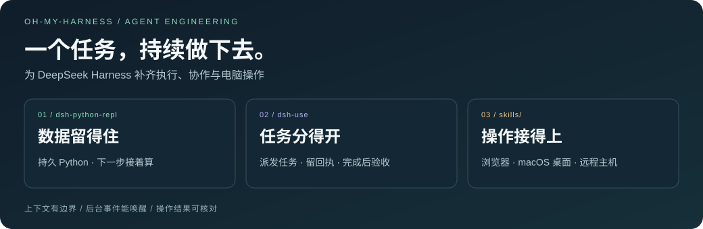
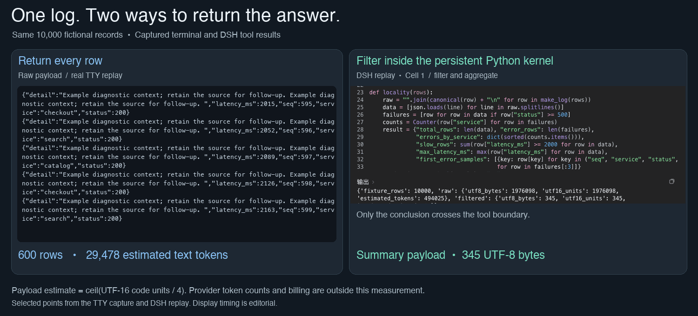

中文 | [English](README.en.md)

# oh-my-harness

**让 Agent 连续做事的工具箱。**

为 [DeepSeek Harness](https://github.com/deepseek-ai/deepseek-harness)（DSH）补上持久 Python、多会话协作和电脑操作。按需装几个部件，也可以从源码研究：一个 Agent 怎样保存中间结果、交接任务、等待事件，再回来核对结果。

[开始使用](docs/getting-started.md) · [全部部件](docs/components.md) · [架构与设计](docs/architecture.md) · [文档导航](docs/README.md)

<picture>
  <source media="(max-width: 600px)" srcset="docs/assets/overview-mobile.svg">
  
</picture>

这是一个独立维护的 **DSH 扩展集合与 harness 实验场**。Harness 是把模型、工具和工作过程接起来的运行环境；DSH 提供宿主，本仓库研究和实现它的扩展。当前主要支持 macOS，不属于 DeepSeek 官方项目。

## 从哪开始

| 你想做什么 | 先看这里 | 能看到的变化 |
| --- | --- | --- |
| 分析大批文件、日志或工具结果 | [持久 Python](dsh-python-repl/README.md) | 数据留在变量里，下一步接着算，对话只放必要证据。 |
| 让多个会话分工做长任务 | [会话控制](dsh-use/README.md) | 派发有回执，完成后通知主控，主控再验收。 |
| 让 Agent 动手操作电脑 | [浏览器](skills/browser-use/README.md) · [桌面](skills/computer-use/README.md) · [SSH](skills/remote-host/README.md) | Cra 和 Chrome 共用网页操作和调试接口。桌面操作选定窗口，SSH 操作选定主机。 |

上下文整理、事件监听、输出防护和界面扩展，按问题查[完整部件目录](docs/components.md)。各部件独立选择，安装步骤留在各自说明中。

## 看一个实际例子

同一份虚构日志：左边展示完整文本，右边在持久 Python 里统计，只返回结论，下一步继续复用变量。

这是录制结果的节选。文本量测量使用固定虚构输入，不代表模型账单或整体速度。[复现方法](benchmarks/README.md) · [派活与验收演示](dsh-use/README.md#实际效果) · [旧版浏览器实拍](docs/browser-use.md#two-tabs)

## 值得研究什么

- DSH 已经能让模型写程序调用工具，为什么还接入了 Prime Agent 的 Python 内核？[从一次统计说起](docs/design/python-data-locality.md)
- 两个标签页同名，两个窗口也可能同名。已有 Agent 怎样找到指定的那个？[Cra 和 Chrome 怎样选定标签页](docs/design/browser-control.md) · [为什么自建 Mac 桌面工具](docs/design/desktop-control.md)
- **任务交接有依据。** 发送回执、执行状态、结果验收分别记录；等待交给后台通知。[设计](docs/design/controller-worker.md)
- **长任务能收口。** 上下文有预算，压缩保留用户原话，失控输出能被拦下。[设计](docs/design/three-generations-of-compaction.md)

[整体架构](docs/architecture.md)说明 DSH、上游 Prime 内核和本仓库分别负责什么。[与 dotfiles 配合](docs/dotfiles.md)说明通用代码怎样和个人配置分开维护。

## 安装之前

从[一个插件](docs/getting-started.md)开始。保留完整源码目录，构建后链接进自己的 DSH 配置，无需使用维护者的 dotfiles。

Python 内核执行可信代码，能访问文件、网络和进程，**不是沙箱**。浏览器、桌面和 SSH 使用真实账号权限；超时不会撤销已发生的动作。安装 Python 组合包会替换 DSH 的 TypeScript 执行后端，并关闭依赖它的工作流条目。详见[安全与限制](SECURITY.md)。

## 一起维护

[贡献指引](CONTRIBUTING.md) · [维护路线](docs/maintenance.md) · [更新记录](CHANGELOG.md) · [报告问题](https://github.com/gwsbhqt/oh-my-harness/issues) · [私密安全报告](SECURITY.md)

MIT 许可。Python 执行与快照核心来自 [Prime Agent](dsh-python-repl/vendor/PROVENANCE.md)，保留其[许可证](dsh-python-repl/vendor/prime/LICENSE)；本仓库负责 DSH 接入、权限与生命周期衔接、工具和技能集成。感谢 DSH 与上游作者。
