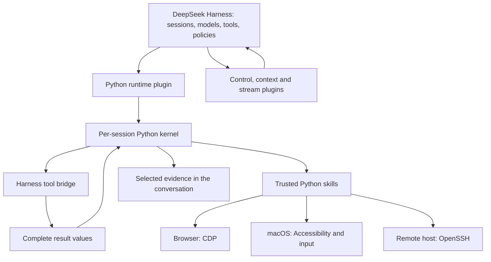

[English](README.md) | [简体中文](README.zh-CN.md)

# oh-my-harness

**Keep the data in code. Put the evidence in the conversation.**

[](https://github.com/gwsbhqt/oh-my-harness/actions)
[](https://github.com/gwsbhqt/oh-my-harness/releases)
[](LICENSE)

Extensions for [DeepSeek Harness](https://github.com/deepseek-ai/deepseek-harness): persistent Python, controller/worker coordination, browser and macOS control, SSH, events, and context helpers. Install only what you need.

An independent community project, **not affiliated with or endorsed by DeepSeek**. DeepSeek Harness is the host; these are unofficial extensions.

```text
Task → DSH agent writes a Python cell → Session kernel
                                      ├─ Harness tools
                                      ├─ Browser / desktop / SSH
                                      └─ Complete values stay in variables
                                                   │
                              Filter, group, verify │
                                                   ▼
                              Evidence → Conversation
```

## See the data flow

The left shows selected moments from a terminal capture of the complete fictional log. The right replays three cells from a real DSH session: filter the same log, return the checked summary, and reuse the data to verify its hash. The counters estimate text payload size.


For results you can inspect now, use the [offline benchmark](benchmarks/README.md) and its [recorded JSON output](benchmarks/results.json). It uses generated fictional data and calls no model.

## Why this exists

| Without | With oh-my-harness |
| --- | --- |
| A verbose tool result enters the conversation in full. | Python keeps the full value and returns a checked answer. |
| One expensive model stays involved throughout a long task. | A controller delegates, then returns for decisions and acceptance. |
| An external script has no bridge into the running DSH. | CLI, Python, and MCP reach its live sessions and receipts. |
| Compaction asks the model to retell the user's wording. | A deterministic appendix copies marked user text and bounds older entries. |
| Agents compete for browser tabs or desktop windows. | Task windows, ownership, and stable references bind the intended target. |
| A remote tool is missing. | SSH preflight fails explicitly; it never substitutes the local machine. |

## Pick a capability

| | | |
| --- | --- | --- |
| **[Python kernel](docs/dsh-python-repl.md)**<br>Keep complete values across cells; return selected evidence. | **[Control and supervision](docs/dsh-control.md)**<br>Reach a running DSH instance; delegate and verify work. | **[Browser](docs/browser-control.md)**<br>Use CDP with task ownership and exact page selection. |
| **[macOS desktop](docs/computer-control.md)**<br>Bind native windows and inspect actions. | **[SSH](docs/remote-host.md)**<br>Use authorized destinations and verify results. | **[Events](docs/dsh-monitor.md) · [Stream guard](docs/dsh-output-guard.md)**<br>Deliver producer events; detect invalid model output separately. |

Independent context helpers: [compaction](docs/dsh-compaction-bound.md), [message tidy](docs/dsh-message-tidy.md), [image cap](docs/dsh-image-cap.md), and [history paging](docs/dsh-history-cap.md). History paging reduces UI transfer, not model context.

## Engineering highlights

- **Discover contracts as needed.** Fixed helpers and configured resident tools keep full contracts; others get summaries and on-demand detail. [Prompt assembly](dsh-python-repl/src/index.ts).
- **Reuse state.** Variables and functions persist across cells. Snapshots restore supported values after kernel changes and report losses. [Session lifecycle](dsh-python-repl/src/session.ts).
- **Check live completion.** Settled checks cover turns, queues, jobs, descendants, goals, and restarts over a stable clear interval. Restart handling resumes interrupted sessions and relaunches recoverable background commands. [Completion](dsh-control/src/service.ts) · [Recovery](dsh-control/src/cli/core.ts).
- **Preserve wording outside the model.** Compaction selects user text by source metadata. Fixed budgets turn older text into indexed entries and ranges. [Appendix implementation](dsh-compaction-bound/src/summary.ts).
- **Bind actions to targets.** Browser tasks can own dedicated windows. Desktop references bind window ID and process generation; directed input never falls back to global input. [Browser targets](skills/browser-control/src/browser_control/engine.py) · [Desktop routing](skills/computer-control/bin/computer-control.swift).
- **Expose uncertain outcomes.** Remote preflight rejects missing capabilities. Browser actions with a lost reply report an unknown outcome and are not replayed. [Remote preflight](skills/_shared/agentkit/remote/target.py) · [Browser RPC](skills/browser-control/src/browser_control/client.py).

## A measured example

Both paths read the same **10,000 fictional JSONL records** to count errors by service and identify samples.

| Returned payload | UTF-16 code units | Estimated tokens |
| --- | ---: | ---: |
| Entire log | 1,976,098 | 494,025 |
| Local Python aggregation and identified samples | 345 | 87 |

Estimates use **ceil(UTF-16 code units / 4)** on returned payload text, not a model tokenizer. See the [method, exclusions, and compaction results](benchmarks/README.md) and [recorded output](benchmarks/results.json).

## Start with one plugin

Use DeepSeek Harness on macOS with a tool-capable model. Follow the [kernel README](dsh-python-repl/README.md) for Node.js, pnpm, uv, and Python requirements.

### 1. Build from source

Plugin builds use adjacent `tooling/`; keep the checkout intact.

```sh
git clone https://github.com/gwsbhqt/oh-my-harness.git
cd oh-my-harness
pnpm --dir dsh-python-repl install --frozen-lockfile
pnpm --dir dsh-python-repl run check
```

### 2. Link the bundle into your DSH profile

Merge these entries into the profile manifest. Set the checkout link **relative to that profile**.

```json
{
  "dependencies": {
    "dsh-python-repl": "link:../../src/oh-my-harness/dsh-python-repl"
  },
  "dsh": {
    "profile": { "bundles": ["dsh-python-repl"] }
  }
}
```

Install in that profile with DSH's pnpm, run startup checks, then restart DSH. Follow the [bundle setup and removal guide](dsh-python-repl/README.md).

### 3. Verify a useful result

From the checkout, create the exact fictional fixture and reference answer:

```sh
python3 benchmarks/run.py --export-log example-log.jsonl --export-conclusion example-answer.json
```

Open a DSH session in the checkout and ask:

> Read the generated example log into a Python variable. Keep the complete data in the kernel. Compute the same counts and identified samples as the benchmark, and compare the result with the exported reference answer. Return the comparison and necessary evidence, not the entire log. In the next cell, reuse the retained data without reading it again.

Check the comparison and reuse the same variable in the next cell.

## Add the control surfaces you need

Root directories contain plugins; `skills/` contains Python tools. Expose trusted skill directories through your agent's discovery mechanism. Find setup and APIs in the [documentation map](#documentation-map).

### Demonstrations

- [Controller/worker handoff](docs/assets/controller-worker.gif): dispatch a check, wait for the receipt, and independently verify the result (recorded excerpts).
- [Browser task](docs/assets/browser-control.gif): complete a fictional checklist and verify the final page state.
- **Native desktop task**: edit fictional text; inspect the target.
- [Event handoff](docs/assets/monitor.gif): a real event wakes an idle session, which verifies the fixture (1× excerpts, `steer` delivery).
- [Bounded display](docs/assets/bounded-display.png): the preview keeps the full Python value and saves the full output.
- [SSH verification](docs/assets/remote-host.png): read-only SSH receipt with an independently verified checksum.

Use the [asset checklist](docs/assets/README.md) for recording inputs and acceptance.

## How the pieces fit



| Responsibility | Host supplies | This repository adds |
| --- | --- | --- |
| Agent execution | Sessions, models, tools, jobs, policies | Extensions, not a new model service. |
| Code | TypeScript programmatic tool calling | Python backend, bridge, skill loading, snapshots. |
| Compaction | Triggers, basic engine, checkpoints | Retention defaults, bounded instructions, exact-user-text appendix. |
| Control | Internal typed services | Local endpoint, CLI/Python/MCP, receipts, settled observation. |
| Devices | Execution and tool-policy context | Skills using CDP, Accessibility, and SSH permissions. |
| Output/events | Jobs, rendering, spill storage, delivery | Display budgets, stream checks, producer delivery. |

## Compare by the problem you have

Choose by the workflow you need. Scope below comes from each project's documentation.

| Option and source | Published scope | When it may be a better fit |
| --- | --- | --- |
| [browser-use][browser-use] | Browser agent with model-written Python, a persistent REPL, and CDP. | Browser-focused agent/library or hosted browsers without DSH. |
| [browser-harness][browser-harness] | Real-browser CDP access for existing agents, through CLI/skill or MCP. | Add browser access to your current coding agent. |
| [cua][cua] | Desktop CLI, MCP, SDKs, and virtual-desktop offerings. | Its desktop/VM ecosystem or platform matrix fits your target. |
| [OmO][omo] | Coding-agent system with multi-model orchestration and memory workflow. | Adopt its integrated workflow for your coding agent. |
| Direct MCP tools: [integration examples][browser-harness] · [protocol architecture][mcp] | Client/server interface for tools and other capabilities. | Existing clients and servers supply your required tools, state, and permissions. |

Python plus CDP is shared ground. This collection adds DSH runtime control and context helpers. `dsh-control` also exposes MCP; each client decides how results enter its transcript.

## Design choices worth inspecting

- [Python data locality](docs/design/python-data-locality.md).
- [Compaction generations](docs/design/three-generations-of-compaction.md).
- [Controller and worker](docs/design/controller-worker.md).
- [Task boundaries](docs/design/task-isolation.md).
- [Output boundaries](docs/design/output-guard.md).

## Security and limits

**The Python kernel is trusted code, not a sandbox.** It can access files, networks, and processes independently of the Harness tool bridge. Configured skills execute Python during import. Host tool approval does not revoke Python's operating-system access.

Browser attachment may use an authenticated profile. Task windows share that profile's account state; debugging access must not be exposed to an untrusted network. Desktop control requires macOS permissions and can affect real windows. Targeted input reduces interference but cannot eliminate focus races. SSH uses the destination account's real permissions, not a simulated remote environment. A timeout does not undo an external action.

The control endpoint is local to the system account; do not proxy it publicly. Its read-only mode and namespace restrictions cover that interface, not arbitrary Python.

The Python bundle replaces TypeScript PTC and disables dependent workflow entries. Startup may download dependencies. Snapshots restore supported values, not live connections or processes. A short display does not prove source completeness. Contract tests check interfaces; live sites and desktops need separate verification.

Read [SECURITY.md](SECURITY.md) for private vulnerability reporting and [CONTRIBUTING.md](CONTRIBUTING.md) for verification. Keep credentials, authenticated screenshots, and real session logs out of issues.

## When something goes wrong

Check the failing boundary: build outputs, skill discovery, original page/window, or send receipt. Inspect complete or saved output before counting. Component READMEs explain recovery.

Use the [bug form](.github/ISSUE_TEMPLATE/bug.yml) with fictional inputs and actual check results; report private findings through [security reporting](SECURITY.md).

## Documentation map

| I want to… | Read |
| --- | --- |
| Keep a large result across cells | [Python kernel](docs/dsh-python-repl.md) |
| Control sessions and supervise work | [DSH control](docs/dsh-control.md) |
| Follow a producer's events | [Monitor](docs/dsh-monitor.md) |
| Diagnose repeated or empty model output | [Output guard](docs/dsh-output-guard.md) |
| Bound summaries and retain exact user text | [Compaction](docs/dsh-compaction-bound.md) |
| Tidy instructions and notices | [Message tidy](docs/dsh-message-tidy.md) |
| Limit images before requests | [Image cap](docs/dsh-image-cap.md) |
| Reduce history transferred to the UI | [History cap](docs/dsh-history-cap.md) |
| Operate a web page | [Browser control](docs/browser-control.md) |
| Operate a native application | [Computer control](docs/computer-control.md) |
| Reach an authorized remote machine | [Remote host](docs/remote-host.md) |
| Reproduce a quoted number | [Benchmarks](benchmarks/README.md) |
| Find the project as an agent | [llms.txt](llms.txt) |

## Contributing, license, and attribution

For small, evidenced changes, start with [CONTRIBUTING.md](CONTRIBUTING.md), the [Code of Conduct](CODE_OF_CONDUCT.md), and [agent guidance](AGENTS.md). Contributors own their generated changes and actions.

Code is [MIT licensed](LICENSE); third-party notices remain, including the [Prime REPL license](dsh-python-repl/vendor/prime/LICENSE) and [provenance](dsh-python-repl/vendor/PROVENANCE.md). Thanks to DeepSeek Harness and upstream authors for the host engine and Python orchestration foundations.

[browser-use]: https://github.com/browser-use/browser-use
[browser-harness]: https://github.com/browser-use/browser-harness
[cua]: https://github.com/trycua/cua
[omo]: https://github.com/code-yeongyu/oh-my-opencode
[mcp]: https://modelcontextprotocol.io/docs/learn/architecture
