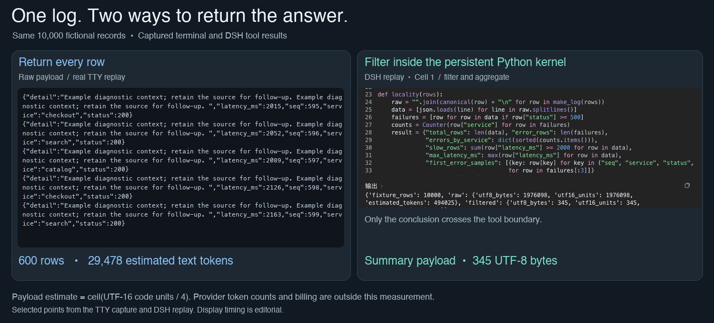
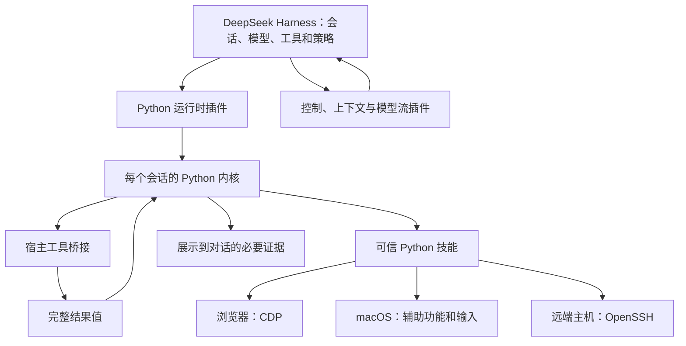

[English](README.md) | [简体中文](README.zh-CN.md)

> 本文为中文说明；内容和行为约定以 [英文版](README.md) 为准。

# oh-my-harness

**数据留在程序里，对话只展示判断所需的证据。**

[](https://github.com/gwsbhqt/oh-my-harness/actions)
[](https://github.com/gwsbhqt/oh-my-harness/releases)
[](LICENSE)

这是给 [DeepSeek Harness](https://github.com/deepseek-ai/deepseek-harness) 的一组扩展：持久 Python 执行、主控与执行端协作、浏览器和 macOS 桌面操作、SSH 远程操作、事件推送，以及上下文处理。按需安装。

本项目由社区独立维护，**并非 DeepSeek 官方产品，也不隶属或获得 DeepSeek 背书**。DSH 是宿主，本仓库提供围绕它工作的插件和技能。

```text
任务 → DSH 中的模型编写 Python → 会话内核
                                 ├─ 调用宿主工具
                                 ├─ 操作浏览器、桌面和 SSH
                                 └─ 完整数据保存在变量中
                                             │
                              筛选、聚合、核对 │
                                             ▼
                                  必要证据 → 对话
```

## 先看数据怎么流动

左侧是完整虚构日志的终端录像选段。右侧回看 DSH 真实执行的三个代码格，依次筛选同一份日志、返回核对后的摘要、复用内核里的数据核对校验值。计数是文本返回量估算。



现在可以直接复核[离线测量](benchmarks/README.md)和[实际输出](benchmarks/results.json)。

## 为什么要做这套扩展

| 原来的麻烦（Without） | 这套扩展怎样处理（With） |
| --- | --- |
| 工具返回一大段日志，整段进入对话。 | 完整数据保存在 Python 变量里，核对后只返回结论。 |
| 长任务始终由昂贵模型参与每一步。 | 主控分配执行端，等需要判断和验收时再回来。 |
| 外部脚本无法通过本机控制入口接上正在运行的 DSH。 | 命令行（CLI）、Python 接口和模型上下文协议（MCP）访问同一实例的会话及回执。 |
| 压缩对话时，让模型重新转述用户说过的话。 | 按消息来源直接提取原话，另附有长度预算的清单。 |
| 多个 agent 抢同一个标签页或桌面窗口。 | 用任务窗口、归属记录和稳定窗口引用绑定目标。 |
| 对面机器缺工具，可能被误改成本机执行。 | SSH 执行前核对远端能力，缺失就报错，不替换成当前机器。 |

## 按需求选择

| | | |
| --- | --- | --- |
| **[Python 内核](docs/dsh-python-repl.md)**<br>跨次执行保留完整数据，只返回必要证据。 | **[控制与监督](docs/dsh-control.md)**<br>操作正在运行的 DSH，派任务后核对结果。 | **[浏览器](docs/browser-control.md)**<br>通过浏览器调试协议（CDP）绑定任务和页面。 |
| **[macOS 桌面](docs/computer-control.md)**<br>绑定原生窗口，操作后检查结果。 | **[SSH](docs/remote-host.md)**<br>明确目标机器，用真实结果核对操作。 | **[事件推送](docs/dsh-monitor.md) · [输出保护](docs/dsh-output-guard.md)**<br>接收生产者事件，另行检测模型异常输出。 |

还有四个可独立安装的上下文插件：[压缩](docs/dsh-compaction-bound.md)、[消息整理](docs/dsh-message-tidy.md)、[图片限制](docs/dsh-image-cap.md)、[历史分页](docs/dsh-history-cap.md)。历史分页负责界面传输。

## 工程亮点

- **说明按需展开。** 固定基础工具和配置指定的常驻工具保留完整说明，其余先给摘要，用到时再查参数和返回值。[提示组装源码](dsh-python-repl/src/index.ts)。
- **跨格复用，换内核后接回。** 变量和函数保留在会话内核中。快照（snapshot）恢复支持保存的值，同时说明哪些状态没有回来。[内核生命周期](dsh-python-repl/src/session.ts)。
- **看实时状态判断做完。** 不读回复里的“已完成”。程序核对回合、队列、后台任务、子代理、持续目标和重启状态，并要求一段连续的稳定状态。重启后续接被打断的会话，重新拉起能够恢复启动信息的后台命令。[完成判据](dsh-control/src/service.ts) · [重启恢复](dsh-control/src/cli/core.ts)。
- **用户原话绕过模型转述。** 压缩附录按来源标记收集文本。固定长度预算放不下旧原话时，先降成轮次清单，再合并最早的范围。[附录实现](dsh-compaction-bound/src/summary.ts)。
- **操作绑定具体目标。** 浏览器任务可以拥有独立窗口。桌面引用同时记录原生窗口号和进程代际；定向输入只发给该进程，不回退到全局输入。[浏览器目标](skills/browser-control/src/browser_control/engine.py) · [桌面投递](skills/computer-control/bin/computer-control.swift)。
- **未知结果原样暴露。** 远端能力不匹配时，在执行前拒绝。浏览器动作已经发出却丢了响应，就返回“结果未知”，不自动重发。[远端预检](skills/_shared/agentkit/remote/target.py) · [浏览器调用](skills/browser-control/src/browser_control/client.py)。

## 一组可以复跑的数据

两条路径都读取同一份 **10,000 条虚构 JSONL 记录**，统计服务错误并找到样本。

| 返回内容 | UTF-16 代码单元 | 估算 token |
| --- | ---: | ---: |
| 完整日志 | 1,976,098 | 494,025 |
| Python 本地聚合及可定位样本 | 345 | 87 |

估算口径是对返回文本计算 **ceil(UTF-16 代码单元 / 4)**，不是模型分词器的精确计数。完整的[方法、排除项和压缩测量](benchmarks/README.md)以及[实测输出](benchmarks/results.json)可直接复核。

## 从一个插件开始

先准备 macOS 上的 DSH 和支持工具调用的模型。Node.js、pnpm、uv、Python 的要求见[内核说明](dsh-python-repl/README.md)。

### 1. 从源码构建

保留相邻的 `tooling/`，插件构建会使用它。

```sh
git clone https://github.com/gwsbhqt/oh-my-harness.git
cd oh-my-harness
pnpm --dir dsh-python-repl install --frozen-lockfile
pnpm --dir dsh-python-repl run check
```

### 2. 链接到 DSH 配置（profile）

把下面的条目合进现有清单。链接路径按**该配置目录到源码的相对位置**填写。

```json
{
  "dependencies": {
    "dsh-python-repl": "link:../../src/oh-my-harness/dsh-python-repl"
  },
  "dsh": {
    "profile": { "bundles": ["dsh-python-repl"] }
  }
}
```

在该配置目录用 DSH 的 pnpm 安装依赖，做启动检查，再重启。详见[组合包安装和移除](dsh-python-repl/README.md)。

### 3. 核对一个有用的结果

在仓库根目录生成同一份虚构日志和参考答案：

```sh
python3 benchmarks/run.py --export-log example-log.jsonl --export-conclusion example-answer.json
```

在该目录打开 DSH 会话，提出任务：

> 把生成的示例日志读进 Python 变量，完整数据留在内核里。统计与测量脚本相同的计数和可定位样本，跟导出的参考答案核对。对话只返回核对结果和必要证据。下一格直接复用刚才的数据，不重新读文件。

检查核对结果，再确认下一格复用了同一个变量。

## 按需要加控制能力

仓库根目录放 DSH 插件，`skills/` 放 Python 工具。把可信技能目录交给 agent 的发现机制；具体设置和接口见[文档索引](#文档索引)。

### 操作演示

- [主控与执行端](docs/assets/controller-worker.gif)：下发任务、等回执、独立重算验收（真实会话节选）。
- [浏览器](docs/assets/browser-control.gif)：填写虚构清单，再核对页面最终状态。
- **原生桌面**：编辑虚构文本，再检查目标窗口。
- [事件推送](docs/assets/monitor.gif)：真实事件唤醒空闲会话，会话核对示例数据（原速节选，`steer` 投递）。
- [有限展示](docs/assets/bounded-display.png)：对话显示首尾，Python 变量和落盘全文仍可复核。
- [SSH 核对](docs/assets/remote-host.png)：只读 SSH 操作回执，校验值经独立核对。

录制输入和验收方式见[素材清单](docs/assets/README.md)。

## 宿主和扩展如何配合



| 职责 | DSH 自带 | 本仓库增加 |
| --- | --- | --- |
| agent 执行 | 会话、模型、工具、任务和策略 | 扩展能力，不另建模型服务。 |
| 程序执行 | TypeScript 程序化工具调用 | Python 后端、桥接、技能加载和快照。 |
| 压缩 | 触发、基础引擎和检查点 | 保留量默认值、有界指令、逐字用户附录。 |
| 控制 | 内部类型化服务 | 本机入口、CLI/Python/MCP、回执和稳定停止观察。 |
| 设备 | 执行及工具策略环境 | 使用真实 CDP、辅助功能和 SSH 权限的技能。 |
| 输出与事件 | 后台任务、显示、完整输出存储和投递 | 显示预算、流检查和生产者事件投递。 |

## 按问题选择其他方案

下面按各项目自己的说明比较适用范围。

| 方案与出处 | 主要范围 | 适合的需求 |
| --- | --- | --- |
| [browser-use][browser-use] | 模型写 Python、持久内核、CDP，以及托管浏览器服务。 | 需要以浏览器为中心的 agent 或库，不必采用 DSH。 |
| [browser-harness][browser-harness] | 给现有编程 agent 接真实浏览器，提供命令行、技能和 MCP 路径。 | 保留现有 agent，只补浏览器能力。 |
| [cua][cua] | 桌面命令行、MCP、SDK 和虚拟桌面。 | 它的桌面、虚拟机生态及平台范围符合目标。 |
| [OmO][omo] | 多模型编程 agent 编排和记忆工作流。 | 希望采用它提供的一整套编程协作方式。 |
| 直接调用 MCP：[集成示例][browser-harness] · [协议架构][mcp] | 连接客户端和服务端，提供工具及其他能力。 | 现有客户端和服务端已能提供需要的工具、状态及权限。 |

Python 加 CDP 是共同基础。这套扩展另外提供 DSH 实例控制和上下文处理；`dsh-control` 也支持 MCP。结果如何进入对话，取决于具体客户端。

## 值得看的设计取舍

- [数据留在内核](docs/design/python-data-locality.md)：完整值、展示和恢复。
- [三代压缩方案](docs/design/three-generations-of-compaction.md)：原话、清单和长度预算。
- [主控与执行端](docs/design/controller-worker.md)：回执、状态和验收。
- [任务边界](docs/design/task-isolation.md)：窗口、目标和归属。
- [输出边界](docs/design/output-guard.md)：展示、模型流和事件历史。

## 安全和使用限制

**Python 内核运行可信代码，不是沙箱（sandbox）。** 它能直接访问文件、网络和进程。配置的技能会在导入时执行 Python；宿主工具审批不会撤销 Python 本身的系统权限。

浏览器可能使用已登录的资料，任务窗口仍共享账号状态。调试入口不能向不可信网络开放。桌面控制需要 macOS 权限，会操作真实窗口；定向输入减少互相干扰，但不能消除所有焦点竞争。SSH 使用目标账号的真实权限。超时不会撤销已经发生的外部动作。

本机控制入口只面向同一系统账号，不应公开转发。只读模式和禁止访问的接口分组只约束这个入口，不约束任意 Python。

Python 组合包会替换原有的 TypeScript 程序化工具调用（PTC）后端，并关闭依赖它的工作流条目。内核启动可能下载依赖。快照能恢复支持保存的值，不能恢复活连接或进程。展示很短也可能只是截断；下结论前仍须核对完整性。接口测试通过，不能代替真实网站和桌面验收。历史分页只减少界面传输，不减少模型上下文。

漏洞走[私密报告](SECURITY.md)，验证方式见[贡献指引](CONTRIBUTING.md)。公开问题中不要放凭据、登录截图或真实会话日志。

## 出错时先看哪里

先定位真正失败的环节：构建产物、技能发现、原页面或窗口、发送回执。计数前检查完整数据或保存的全文。恢复步骤见对应组件说明。

用[缺陷表单](.github/ISSUE_TEMPLATE/bug.yml)提供虚构复现和实际检查结果；私密发现走[安全报告](SECURITY.md)。

## 文档索引

| 我想…… | 从这里开始 |
| --- | --- |
| 跨次执行保留数据 | [Python 内核](docs/dsh-python-repl.md) |
| 控制会话和监督任务 | [DSH 控制](docs/dsh-control.md) |
| 接收持续事件 | [Monitor](docs/dsh-monitor.md) |
| 排查重复或空白模型输出 | [Output guard](docs/dsh-output-guard.md) |
| 控制摘要并保留原话 | [上下文压缩](docs/dsh-compaction-bound.md) |
| 整理指令与通知 | [消息整理](docs/dsh-message-tidy.md) |
| 限制请求图片 | [图片限制](docs/dsh-image-cap.md) |
| 减少界面历史传输 | [历史分页](docs/dsh-history-cap.md) |
| 操作网页 | [浏览器控制](docs/browser-control.md) |
| 操作原生应用 | [电脑控制](docs/computer-control.md) |
| 访问授权的远端机器 | [远端主机](docs/remote-host.md) |
| 复核数字 | [测量说明](benchmarks/README.md) |
| 为 agent 找入口 | [llms.txt](llms.txt) |

## 贡献、许可与致谢

从[贡献指引](CONTRIBUTING.md)、[行为准则](CODE_OF_CONDUCT.md)和[agent 协作指引](AGENTS.md)开始。提交者对生成内容及外部动作负责。

代码使用 [MIT 许可](LICENSE)。保留第三方声明，包括 [Prime 内核许可](dsh-python-repl/vendor/prime/LICENSE)和[来源记录](dsh-python-repl/vendor/PROVENANCE.md)。感谢 DeepSeek Harness 及上游作者提供宿主引擎和 Python 编排基础。

[browser-use]: https://github.com/browser-use/browser-use
[browser-harness]: https://github.com/browser-use/browser-harness
[cua]: https://github.com/trycua/cua
[omo]: https://github.com/code-yeongyu/oh-my-opencode
[mcp]: https://modelcontextprotocol.io/docs/learn/architecture