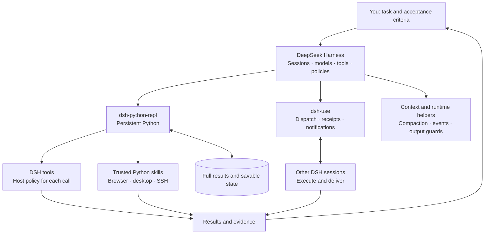

[中文](architecture.md) | English

# How one task keeps moving

[← Documentation](README.en.md) · [All components](components.en.md)

DSH owns sessions, models, tools, and execution policies. oh-my-harness adds three capabilities: retain program state, coordinate other sessions, and operate explicit device targets. Context and runtime helpers support that work.

## Responsibility by layer



This is a responsibility map, not a security isolation diagram. Python and trusted skills have direct system access; host tool approvals cover operations routed through the tool pipeline. Read the [security guide](../SECURITY.en.md).

| Layer | Provided by DSH or upstream | Owned here |
| --- | --- | --- |
| Sessions and models | DSH's agent loop, model connections, goals, and task services | Extend the host while preserving call ownership. |
| Python execution | Prime's persistent execution and snapshot core | DSH integration, per-cell tool authority, background work, recovery reports, skill loading, and display budgets. |
| Session coordination | DSH's session and subagent services | Running-instance access, receipts, settled-state observation, notifications, and independent acceptance workflows. |
| Computer operations | Official Cra MCP, Google’s Chrome DevTools MCP, macOS Accessibility, and OpenSSH | Page and debugging APIs shared by the browsers, window and host selection, and result inspection. |
| Long-task context | DSH messages and compaction | Exact user-text appendices, length budgets, message cleanup, and output guards. |

DSH already lets a model call several tools in one program. This project keeps that entry point and integrates Prime’s Python execution and snapshot code so the next cell can reuse a variable. The variable might hold the first of two tabs with identical titles and URLs. In a native Mac app, sending input also requires identifying the receiving process and window. [Kernel design](design/python-data-locality.en.md) · [Archived two-tab experiment](browser-use.en.md#two-tabs) · [Choosing a window](design/desktop-control.en.md) · [Prime sources and hashes](../dsh-python-repl/vendor/PROVENANCE.md)

## Follow a result

1. The agent writes Python, calls a tool, and assigns the returned data to a variable.
2. The program checks pagination, truncation, and unreadable scope before filtering or aggregating. Full returned values stay in the kernel.
3. The conversation displays a conclusion and identifiable samples. The next cell can reuse the variable.
4. When work moves to another session, the sender saves the receipt, waits for a background notification, and inspects the deliverable.
5. After an error, cancellation, or restart, inspect surviving state first. Restoring a variable does not undo external actions or restore live connections.

Data completeness, execution settlement, and result correctness are separate questions. Each needs evidence beyond a reply saying “done.”

## Why the directories look this way

```text
oh-my-harness/
├── dsh-*/             Independent DSH plugins: manifests, source, tests, READMEs
├── skills/            Reusable operation skills
│   └── _shared/       Transport, target handling, and command dispatch
├── tooling/           Builds, contracts, scaffolding, and startup checks
├── docs/              Guides and documentation navigation
│   ├── design/        Tradeoffs and source evidence
│   ├── examples/      Demo inputs without accounts
│   └── assets/        Editable diagrams and reviewed recordings
└── benchmarks/        Fictional workloads, scripts, and reproducible results
```

Each `dsh-*` has its own manifest and dependencies. Components are installed individually. Shared build utilities rely on the current relative layout; keeping root plugin paths preserves existing linked installations. Documentation provides categories without moving running source just to tidy the home page.

`docs/` is organized around reader questions. Component READMEs own exact options, while design articles cite source instead of duplicating parameter tables. Chinese is the default; English documents use paired `.en.md` files.

## Source reading map

| What to study | Entry point |
| --- | --- |
| Kernel startup, recovery, and reclamation | [session.ts](../dsh-python-repl/src/session.ts) |
| When per-cell tool authority is valid | [lease.ts](../dsh-python-repl/src/lease.ts) · [background tools](../dsh-python-repl/src/background-tools.ts) |
| Dispatch, status, and settlement | [service.ts](../dsh-use/src/service.ts) · [done notifications](../dsh-use/src/done-watch.ts) |
| Browser page actions and debugging | [Python API](../skills/browser-use/src/browser_use/__init__.py) · [Selecting a browser and tab](browser-use.en.md) |
| Native desktop actions | [computer-use.swift](../skills/computer-use/bin/computer-use.swift) |
| Remote selection and capability checks | [target.py](../skills/_shared/agentkit/remote/target.py) |
| User-text appendices after compaction | [summary.ts](../dsh-compaction-bound/src/summary.ts) |

Continue with [design articles](README.en.md#read-by-scenario), [dotfiles boundaries](dotfiles.en.md), or the [maintenance roadmap](maintenance.en.md).
