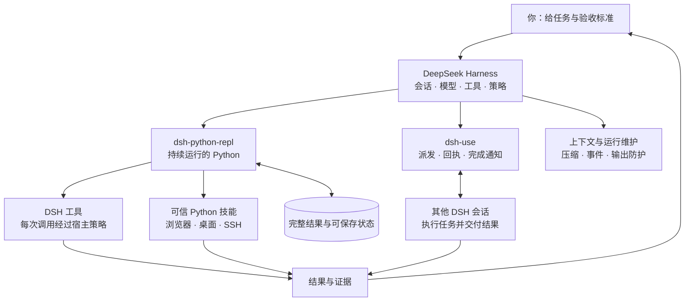

中文 | [English](architecture.en.md)

# 一个任务怎样持续做下去

[← 文档导航](README.md) · [全部部件](components.md)

DSH 负责会话、模型、工具与执行策略。oh-my-harness 在这个宿主上增加三条能力：保留程序状态、协调其他会话、操作明确的设备目标。上下文与运行维护插件配合它们工作。

## 谁负责哪一层



图中是职责关系，不是安全隔离图。Python 和可信技能能直接访问系统；宿主的工具审批只覆盖走工具调用链的操作。详见[安全说明](../SECURITY.md)。

| 层 | DSH 或上游提供 | 本仓库负责 |
| --- | --- | --- |
| 会话与模型 | DSH 的执行循环、模型连接、目标和任务服务 | 扩展宿主能力，并保持它的调用归属。 |
| Python 执行 | Prime 的持久执行与快照核心 | 接入 DSH、每格工具授权、后台任务、恢复报告、技能加载和展示预算。 |
| 多会话协作 | DSH 的会话与子代理服务 | 控制运行中实例、保存回执、观察停止状态、通知与独立验收流程。 |
| 设备操作 | 浏览器调试接口、macOS 辅助功能、OpenSSH | 固定目标、调用入口、错误与结果核对。 |
| 长任务上下文 | DSH 的消息和压缩机制 | 用户原话附录、长度预算、消息整理和输出防护。 |

[Prime 来源清单](../dsh-python-repl/vendor/PROVENANCE.md)记录原件与哈希。自有代码围绕接入和执行边界展开，保留上游署名。

## 跟着一份结果走

1. Agent 写 Python 调工具，取回数据并赋给变量。
2. 程序检查分页、截断和不可读范围，再筛选或汇总。完整的已返回值留在内核里。
3. 对话展示结论和可定位样本。下一格可以继续操作同一个变量。
4. 如果工作交给其他会话，发起者保存回执，等待后台通知，再检查交付物。
5. 异常、取消或重启后，先核对保留下来的状态。恢复变量不代表外部动作被撤销或连接已恢复。

这里有三个独立问题：数据是否完整、执行是否停下、结果是否正确。它们分别需要证据，不能由一句“完成了”代替。

## 目录为什么这样放

```text
oh-my-harness/
├── dsh-*/             独立 DSH 插件：自己的清单、源码、测试与说明
├── skills/            可复用的操作技能
│   └── _shared/       传输、选机和命令分派的共用实现
├── tooling/           插件构建、契约、脚手架和启动检查
├── docs/              使用指南与文档导航
│   ├── design/        设计取舍及源码证据
│   ├── examples/      不含账号的演示输入
│   └── assets/        可编辑示意图和已审查演示
└── benchmarks/        虚构输入、测量脚本与可复核结果
```

每个 `dsh-*` 有自己的包清单和依赖，不是一个必须整包安装的应用。共享构建工具依靠当前相对位置；保留根目录的插件路径，可兼容现有链接安装。新增分类通过文档目录表达，避免仅为了首页整齐就搬动运行源码。

`docs/` 按读者的问题组织；组件 README 保留配置与精确参数，设计文章引用源码，不复制另一份参数表。文档默认中文，英文使用 `.en.md` 配对。

## 从哪读源码

| 想研究什么 | 从这里进入 |
| --- | --- |
| Python 内核的启动、恢复与回收 | [session.ts](../dsh-python-repl/src/session.ts) |
| 每格工具权限何时有效 | [lease.ts](../dsh-python-repl/src/lease.ts) · [后台工具](../dsh-python-repl/src/background-tools.ts) |
| 派单、状态判断和停止条件 | [service.ts](../dsh-use/src/service.ts) · [完成通知](../dsh-use/src/done-watch.ts) |
| 浏览器动作与目标 | [engine.py](../skills/browser-use/src/browser_use/engine.py) · [客户端回执](../skills/browser-use/src/browser_use/client.py) |
| 原生桌面操作 | [computer-use.swift](../skills/computer-use/bin/computer-use.swift) |
| 远程选择与能力检查 | [target.py](../skills/_shared/agentkit/remote/target.py) |
| 压缩后的用户原话附录 | [summary.ts](../dsh-compaction-bound/src/summary.ts) |

继续读[设计文章导航](README.md#按场景读)、[与 dotfiles 的边界](dotfiles.md)或[维护路线](maintenance.md)。
