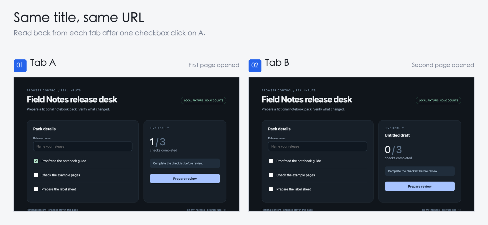

[中文](browser-control.md) | English

# Two tabs have the same URL. Which one gets the click?

Use the ID returned when the tab opens to tell which page received a click. In the archived browser-use experiment, the same fictional notebook checklist was opened twice in a separate Chrome instance. Only the first tab received a click. Both had the same title and URL, but the first counter read 1/3 and the second 0/3. The capture below comes from that archived version. [Original steps and capture](../browser-use.en.md#two-tabs)

## Why page control and debugging have separate APIs

An existing agent already knows which page to read or which control to click. With browser-use it can write the same page call for either browser, such as `page_snapshot(tabId=...)`. Cra runs it through its official MCP. For Chrome the adapter translates the same arguments into Google’s Chrome DevTools MCP operations. To inspect network requests on either browser, call `debug_network(tabId=...)`. Both use Google’s tools and require a debugging endpoint for the selected browser. [Python and CLI examples](../browser-use.en.md)

Each browser also has its own features. Cra owns its sidebar, spaces, and pinned tabs. Use `capabilities` to check support before relying on a browser-specific action. Chrome connects to the running instance named by the caller’s debugging endpoint and uses that profile’s login state.

## Keep each tab ID on its connection

In Python, keep one `Browser` object, open the tab, save the returned `tabId`, and pass it to the page and debugging calls that follow. An MCP client can keep a connection open with the `mcp` subcommand. If you open the same URL twice, keep both IDs and close only the tabs your task created.

Suppose an agent clicks “Add checklist item.” The site might add the row just before the reply is lost. Clicking again could add a second row. Read the list in the original tab first. If that tab cannot be identified, resolve its identity before taking another action. The [archived design](https://github.com/gwsbhqt/oh-my-harness/blob/archive/browser-use-before-mcp/docs/design/browser-control.en.md) describes the previous background service, SSH routing, and page recovery logic.

## Choosing a tool

**For a task you want a model to plan and carry out, consider the open-source Browser Use agent.** The separate `browser-use/browser-use` project’s 1.0 `Agent` writes Python in a persistent interpreter, uses `browser-harness` helpers or calls the Chrome DevTools Protocol (CDP) directly, and reads the result before choosing another step. The same team also offers the underlying Browser Harness to existing coding agents. For direct control of a signed-in Chrome, upstream recommends the Browser Use CLI. It can attach to Chrome with remote debugging enabled or connect to an explicit CDP endpoint. Browser Use Cloud covers a different need. It can host the browser while your own Playwright or other CDP client drives it.

**For a known sequence, a CLI or a testing library may already fit.** Vercel’s `agent-browser` accepts exact tab target IDs and can reuse its daemon across shell commands. For regression tests on each code change, Playwright provides role and label locators, waits for elements to become actionable, and can load saved authentication state into a fresh test context. It can also attach to an existing Chromium-based browser over CDP. Its documentation notes that some advanced operations work better over Playwright’s own protocol.

**Use this repository’s tool when one script needs to drive both Cra and Chrome.** The browsers share page and debugging APIs. Keep the tab ID returned on the chosen connection to match an action with the page that received it. Tabs in the same profile share login state, so signing out can affect someone using another tab.

## Source and upstream documentation

- Follow the browser selection and dispatch for page and debugging calls. [Python entry point](../../skills/browser-use/src/browser_use/browser.py) · [Page and debugging examples](../browser-use.en.md) · [Task isolation beyond the browser](task-isolation.en.md)
- Check the operations available in each upstream interface. [Official Cra MCP](https://github.com/VictorKildahl/cra/blob/v0.1.53/docs/mcp.md) · [Chrome DevTools MCP](https://github.com/ChromeDevTools/chrome-devtools-mcp)
- Browser Use documents the agent, browser choices, CLI and programmable cloud browsers separately. [Agent](https://docs.browser-use.com/open-source/agent) · [Underlying Browser Harness](https://github.com/browser-use/browser-harness) · [Browsers and existing logins](https://docs.browser-use.com/open-source/browsers) · [Browser Use CLI](https://docs.browser-use.com/open-source/browser-use-cli) · [Direct cloud browser connections](https://docs.browser-use.com/cloud/browser/playwright-puppeteer-selenium)
- Other options for scripts and tests. [Vercel agent-browser release README](https://github.com/vercel-labs/agent-browser/blob/v0.39.0/README.md) · [Playwright locators](https://playwright.dev/python/docs/locators) · [Reusing authentication state](https://playwright.dev/python/docs/auth) · [Connecting over CDP](https://playwright.dev/python/docs/api/class-browsertype#browser-type-connect-over-cdp)
