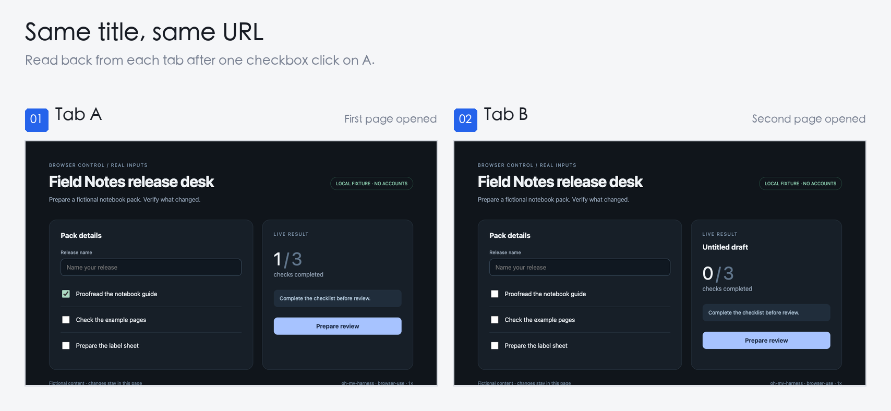

中文 | [English](browser-control.en.md)

# 同一个网址开了两次，助手该改哪一页？

在一个独立的 Chrome 里，把同一份虚构的笔记本校对清单打开两遍。两个标签页的标题和网址完全相同，浏览器给它们的页面标识却不同。第二页打开后，脚本仍持有打开第一页时拿到的 `Page` 对象。用它勾选“校对笔记本指南”，动作就发往第一页。再分别读取两页的计数和复选框，先开的页完成了 1/3，后开的页仍是 0/3，两处勾选状态也各自对应。这个例子可以在本机复现。[两页对照的操作步骤](../browser-use.md#two-tabs)

## 为什么从命令行入口做成了一个项目

早期的命令行入口用的是 Vercel 的 `agent-browser`。当时的设计面对的是一个已经会写代码的助手。它能自己决定下一步，需要工具把动作送到指定页面，再把可检查的结果交回来。于是自有工具从一开始就留了两个入口。只能用终端的助手调用命令行，有 Python 环境的助手可以保留 `Page` 对象，把几步操作写在一起。后续计划也沿用了这个取舍，优先补脚本和网页调试中缺的动作，能用现有调用组合出来的就留给脚本。

两个入口共用一套按需启动的后台服务。命令行退出后，下一次调用仍可带上原任务和确切的页面标识。后来加入远程执行时，请求经 SSH 送到选定机器，由那里的服务连接浏览器。后来让多个 Chrome 任务共用已授权的调试连接，是为了少让人重复批准连接。各个任务仍然只管自己的页面。今天从接口可以看到，这个页面标识能传给另一个入口，Python 的 `Page` 也会记住原机器、任务和浏览器。后来改选默认机器，手里的对象仍指向原页。这也是自建需要承担的维护工作，两个入口、远程传输和服务恢复都得遵守同一约定。

## 共用登录时，窗口归谁

若任务要沿用 Mac 上已经登录的 Arc 或 Chrome，`open_window()` 会连接已获授权的日常浏览器，在同一份浏览器资料里给任务开新窗口。开着多份资料时，要用来源页的确切标识选择哪一份。这个入口禁止自动重启浏览器或改用资料副本。普通 Chrome 的 `attach` 调用则有另一种默认行为，连接失败时可以回退到资料副本。网站登录和设置仍然共享，任务退出账号也会影响用这份资料的人。新窗口还可能被浏览器置前。只需干净环境时，新任务用 `open_page()` 打开 Chrome，默认使用独立资料。Chrome 也可显式选择复制资料，Arc 只支持连接已有实例。

后台服务记录页面属于哪个任务，以及它是任务创建的，还是借来操作的。释放任务时，自建页会关闭，借用页留给原来的人。断线后显式调用 `page.recover()`，服务要能核对原绑定、浏览器实例、任务归属和仍然存在的原页。即便新的浏览器用了同一调试地址，或者另一页有相同网址，恢复也会被拒绝。

这会直接影响调用方怎样处理一次点击。假设助手按了“添加清单项”，还没收到回复，连接就断了。工具把这种结果标为 `unknown`。换到命令行再点一次，可能多添一行。应先恢复原页并读回清单，再决定是否还需要添加。公开的断连测试用本地 WebSocket 模拟对端收到了请求便关掉连接，检查错误是否标为结果未知，以及对端实际收到了几次。远程路由测试另行检查，指定机器断连时只调用它一次，错误直接返回给调用方。

## 读者该选哪种工具

**要把整件事交给模型规划，选开源项目 Browser Use 的 Agent。** `browser-use/browser-use` 是另一个项目。它的 1.0 `Agent` 接收任务，让模型在能保留变量的 Python 环境里写代码，调用 `browser-harness` 提供的函数或直接使用 Chrome 调试协议（CDP），读取结果后决定下一步。本仓库的工具也走 CDP。同一团队也把底层的 Browser Harness 提供给已有的编码助手。只需直接操作已登录的 Chrome 时，上游推荐的 Browser Use CLI 就能完成这件事。它可以连接已开放调试的本机 Chrome，也能连接指定的 CDP 地址。希望让服务商运行浏览器、自己控制每一步时，Browser Use Cloud 能提供可供 Playwright 等客户端直接连接的浏览器。

**已有一套固定流程，可以从现成的命令行或测试库入手。** Vercel 的 `agent-browser` 能按确切的标签页标识选页，多条命令也能复用后台进程。如果目标是让每次代码改动都跑同一组验收，Playwright 可按角色或标签找到元素，自动等待可操作状态，并让新的测试环境复用先前保存的登录状态。它也能通过 CDP 连接已运行的 Chromium 系浏览器。Playwright 官方文档说明，这样连接时，部分高级能力不及它自己的连接协议。

**当同一助手任务要跨命令行、Python 或指定的 Mac 继续工作时，本仓库的工具把那些选择记了下来。** 如果还要与人共用 Arc 或 Chrome 的登录、按任务清理窗口、在回执丢失时回到原页核对，这些正是它已经放进服务和测试里的约定。上面的实拍覆盖的是独立 Chrome 中两个同名页面。日常浏览器的连接还取决于该版本能否提供可用的调试入口，以及用户对连接的授权。

## 源码、测试与官方资料

- 两个入口如何抵达浏览器，以及新窗口和页面绑定如何建立。[Python 页面接口](../../skills/browser-use/src/browser_use/__init__.py) · [命令行](../../skills/browser-use/src/browser_use/commands.py) · [执行引擎](../../skills/browser-use/src/browser_use/engine.py) · [远程传输](../../skills/browser-use/src/browser_use/transport.py)
- 对照共享资料、选错目标、断线与释放的实际断言。[窗口与资料测试](../../skills/browser-use/tests/test_browser_modes.py) · [连接与恢复测试](../../skills/browser-use/tests/test_core.py) · [选机与调用次数测试](../../skills/browser-use/tests/test_routing_contract.py) · [页面归属记录](../../skills/browser-use/src/browser_use/resources.py) · [桌面与任务隔离的边界](task-isolation.md)
- Browser Use 对任务规划、浏览器选择、命令行直控和托管浏览器分别有说明。[Agent](https://docs.browser-use.com/open-source/agent) · [底层 Browser Harness](https://github.com/browser-use/browser-harness) · [浏览器与已有登录](https://docs.browser-use.com/open-source/browsers) · [Browser Use CLI](https://docs.browser-use.com/open-source/browser-use-cli) · [直接连接云浏览器](https://docs.browser-use.com/cloud/browser/playwright-puppeteer-selenium)
- 两个可直接用于脚本的选择。[Vercel agent-browser 定版说明](https://github.com/vercel-labs/agent-browser/blob/v0.39.0/README.md) · [Playwright 元素定位](https://playwright.dev/python/docs/locators) · [复用登录状态](https://playwright.dev/python/docs/auth) · [通过 CDP 连接](https://playwright.dev/python/docs/api/class-browsertype#browser-type-connect-over-cdp)
