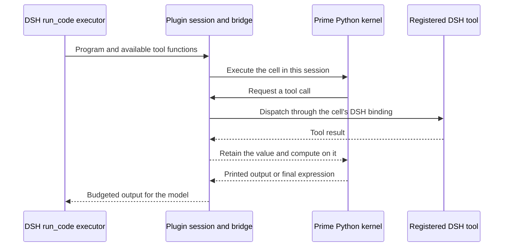

[中文](python-data-locality.md) | English

# Keep the data in Python, put the evidence in the conversation

A report counts 104 errors in 10,000 fictional log records. A reader asks which service had the most errors. The report already contains the counts by service. Fetching again could sample a different set of records, while printing the whole report gives the model a filtering job a program can do. How long does the program need to keep its answer around?

## One tool, one program, or a series of questions?

**Call the tool directly for a small, self-contained answer.** To check one setting, read the relevant lines. DSH's native executor exposes the tools available to the agent by name. It works well when the result is short and a person or the model needs to decide what to do next.

**Use built-in programmatic tool calling (PTC) when the steps are already known.** The model makes one `run_code` call. Its program can search for a term, read the matching files and return just the passages of interest. DSH still dispatches each search and read under its own tool policy. Intermediate values can pass between tools without a model turn to carry them.

The Node runtime shipped with DSH 0.2.2-rc.3 takes TypeScript. Its default `per-call` setting runs an async function body in a fresh process. Within that call, `await` can connect several tools and `return` can supply the answer. DSH also offers `persistent-in-memory`, and `vm-script` with `scriptPersistence` enabled. Both can keep top-level state in memory for a live agent across calls. Disposing the agent or restarting the host clears that state. The built-in runtime is a good fit when a program needs DSH's process-level file sandbox or its TypeScript workflows.

**Choose a persistent Python REPL for repeated questions about the same data in Python.** With `dsh-python-repl`, each `run_code` invocation executes a cell in the session's Python process. A later cell can use variables and functions from earlier ones. Snapshots let serializable values survive replacement of that process. Cells support top-level `await` and display a trailing non-`None` expression. Its value is available as `_` until another such expression replaces it. Give reusable results names of their own.

The web interface's **PTC mode** is a preset that exposes `run_code` as the model's only direct tool. Other tools are callable inside a program. The runtime mounted on the host determines which language that program uses. The plugin also has a separate, off-by-default option to give Creator mode the same tool presentation. Choosing a preset and choosing an interpreter control different parts of a call.

## Borrowing Prime's kernel while keeping the DSH tool path

The design started with two requirements. Ordinary Python variables and functions should work in the next cell, and DSH should continue to schedule tools, handle approvals and record calls in the session. One design considered a Python function body per invocation, with explicit reads and writes to shared state. Another paired a new REPL entry point with the full Prime SDK. The first placed state management in each program. The second left the plugin to reconnect execution and output to the host. The choice was to keep DSH's `run_code` entry point, supply the runtime behind it and reuse Prime's core.

Prime Intellect's Prime Agent is a standalone coding and research agent. Its persistent Python environment is the agent's built-in tool. It can orchestrate files, shell commands, MCP tools and child agents in code. The complete harness suits a long-running experiment whose operator wants to disconnect a terminal and reattach later. From the upstream revision pinned for `v0.10.3`, this plugin ships the executable kernel `repl.py`, its protocol description `repl.md` and the upstream MIT license with its copyright notice. All three files are unchanged. The plugin distributes its own code under MIT as well and retains Prime’s separate notice. The persistent Python namespace and its snapshot serializer come from that kernel.

The plugin supplies the DSH tool bridge, manages processes and snapshots per session, bounds cell output and imports trusted Python skills. Locally maintained modules under `python/compat/rlm` satisfy the kernel's `bash` and `factory` imports. Commands, MCP calls and subagents go through DSH's own facilities. DSH retains ownership of the tool catalog and execution policy. The plugin is responsible for adapting to kernel protocol changes.



There is a concrete compatibility limit in the current composition. The bundle disables the official Node backend and registers Python in the same `ptcRuntime` service slot. The official executor still binds the tools visible to the agent for that call. DSH's workflow engine checks for TypeScript when it starts, so the Python composition disables the corresponding workflow entries. Use the Node composition for existing TypeScript programs. In Python, `repl.agent` can delegate to a DSH subagent and retrieve its result.

## A follow-up question without a second fetch

Run the following as two cells in the plugin, from the repository root. The first calls the public benchmark through the DSH `bash` tool. Awaiting `run` collects the command result. `repl.require_complete` checks the exit status and the completeness of standard output before JSON parsing.

```python
run = await bash("python3 benchmarks/run.py --check benchmarks/results.json", "Check the fictional log measurement")
report = json.loads(await repl.require_complete(await run))
counts = report["locality"]["result"]
counts["total_rows"], counts["error_rows"]
```

The first cell yields `(10000, 104)`. The follow-up reads the counts and sample IDs from the same object.

```python
counts["errors_by_service"], [row["seq"] for row in counts["first_error_samples"]]
```

Its result is `({'catalog': 35, 'checkout': 35, 'search': 34}, [0, 97, 194])`. Two services tie for first place. The benchmark ran once. `report` contains the entire report the script returned, including the group totals and three samples. A new analysis of individual records would require the source rows.

A tool's returned value and the model's view of it have different limits. A result-safety test supplies a synthetic write response to a real kernel. The display stays short and the next cell reads a field 1,200,000 characters long. Another test ends a cell on a 200,000-item list. After the host bounds the display, `len(_)` in the next cell returns `200000`. A search that skipped unreadable paths, a single page of results or a field clipped at the source still needs attention before counting. Retaining an object preserves only the data the tool actually delivered.

## What carries over

Names age by the number of user cells that haven't used them. By default an unpinned name is archived after 100 such cells and deleted after 200. Idle time does not count. Referencing a name in later source can bring it back from the archive. Dynamic lookup can hide a dependency, so `repl.keep` is useful for expensive intermediate results. `repl.list` and `repl.describe` inspect the live namespace.

After a successful cell the host schedules a snapshot with a 1.5-second debounce. It also tries to save before an orderly close or restart. A new kernel rebuilds its tools and skills before restoring serializable data, functions and classes. It resolves modules and skills by name in the new environment. Attributes added to the old module by hand may be lost. The restore report identifies values that could not be saved or restored, and closing the kernel after an incomplete restore preserves the previous snapshot. A crash can lose changes since the last save. Connections need reopening, and processes and tasks have their own status to check.

**Variables can outlive a cell. Its tool permissions expire when it settles.** The bridge uses the cell identifier and kernel generation to select the functions DSH bound to that invocation. A stray async task from a completed or cancelled cell cannot borrow the next cell's grant. Explicit work started with `repl.background` has a separate, tracked grant restricted to the originating cell's tools. It expires when the job ends. The interpreter itself runs trusted Python with access to host files, the network and processes. DSH approvals govern calls routed through DSH.

An exception or cancellation can interrupt a sequence after assignments or file writes have taken effect. A timeout can also leave an action completed with its reply still missing. Inspect the existing state and the destination before retrying. Tool failures arrive as `ToolCallError`. Cancellation arrives as `asyncio.CancelledError` and should propagate.

## Measuring the text returned to the conversation

The published measurement starts both paths with the same 10,000 generated JSONL records and checks row counts, error totals, the sum of group counts and sample lookup. Returning all records takes 1,976,098 UTF-16 code units. Returning the counts and three identified samples takes 345. The chosen `ceil(UTF-16 units / 4)` estimator gives 494,025 and 87 estimated tokens respectively. The script uses standard Python and measures the returned text alone. Model-specific tokenization, prompts, tool definitions, transport, reasoning and cache accounting fall outside that measurement.

The two-cell example used the running DSH tool bridge. Separate component tests exercise bounded display, per-cell authority, cancellation and snapshot recovery. The snapshot test starts a new kernel by replacing the session object while keeping its temporary state directory, then checks that restored functions read current variables. Desktop application restarts and external service execution require separate verification.

## Sources and reproducible checks

- DSH 0.2.2-rc.3 documents [direct calls](https://github.com/deepseek-ai/deepseek-harness/blob/38a6a5c965aa99ab525161efb7cc5cf1fe62fced/packages/core/tool-executor-native/README.md), [the PTC executor](https://github.com/deepseek-ai/deepseek-harness/blob/38a6a5c965aa99ab525161efb7cc5cf1fe62fced/packages/core/tool-executor-ptc/README.md) and [Node execution and state lifetime](https://github.com/deepseek-ai/deepseek-harness/blob/38a6a5c965aa99ab525161efb7cc5cf1fe62fced/packages/ptc-runtime/ptc-runtime-node/README.md). The shipped sources include the [web PTC preset](https://github.com/deepseek-ai/deepseek-harness/blob/38a6a5c965aa99ab525161efb7cc5cf1fe62fced/packages/bundle/web-app/presets/ptc.patch.yml) and the [workflow language check](https://github.com/deepseek-ai/deepseek-harness/blob/38a6a5c965aa99ab525161efb7cc5cf1fe62fced/packages/workflow/workflow-ptc/src/index.ts).
- Prime Agent publishes its [project guide](https://github.com/PrimeIntellect-ai/prime-agent/blob/efb25e2be62507f8a13a157545d031da213abac9/README.md), [cell and snapshot protocol](https://github.com/PrimeIntellect-ai/prime-agent/blob/efb25e2be62507f8a13a157545d031da213abac9/prime-agent-runtime/src/rlm/repl.md) and [MIT license](https://github.com/PrimeIntellect-ai/prime-agent/blob/efb25e2be62507f8a13a157545d031da213abac9/LICENSE) at the pinned revision. This repository keeps [upstream provenance and hashes](../../dsh-python-repl/vendor/PROVENANCE.md), the [local compatibility layer](../../dsh-python-repl/python/compat/README.md), the [plugin license](../../dsh-python-repl/LICENSE) and [vendor and wire-protocol tests](../../dsh-python-repl/test/python/test_vendor_integration.py).
- Follow the integration through the [bundle patch](../../dsh-python-repl/cordis.patch.yml), [runtime registration and bindings](../../dsh-python-repl/src/index.ts), [session coordinator](../../dsh-python-repl/src/session.ts), [per-cell leases](../../dsh-python-repl/src/lease.ts) and [background job grants](../../dsh-python-repl/src/background-tools.ts).
- Regression tests cover [returned values](../../dsh-python-repl/test/result-safety.test.ts), [display limits](../../dsh-python-repl/test/output-budget.test.ts), [expired leases](../../dsh-python-repl/test/lease.test.ts), [cancellation and completed effects](../../dsh-python-repl/test/cancel.test.ts), [variable lifetime](../../dsh-python-repl/test/name-lifecycle.test.ts) and [kernel replacement](../../dsh-python-repl/test/kernel-snapshot.test.ts).
- Reproduce the log measurement with the [benchmark guide](../../benchmarks/README.en.md), [generator and checks](../../benchmarks/run.py) and [published results](../../benchmarks/results.json).
