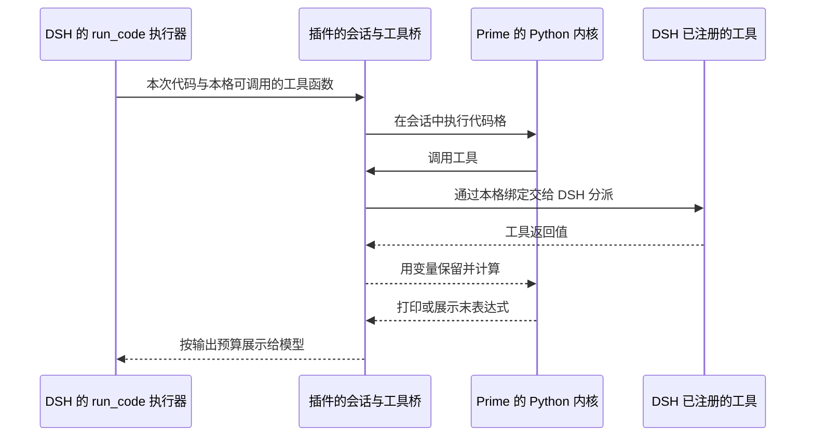

中文 | [English](python-data-locality.en.md)

# 数据留在 Python，证据放进对话

一份报告说，一万条虚构日志中有 104 条异常。接着问“哪个服务的异常最多”，只需要报告里的分组计数。重新采集可能遇到已经变化的数据，把整份报告送进对话又让模型做了程序擅长的筛选。该用哪种工具调用方式，取决于这份值要用到什么时候。

## 从一次调用，到下一次追问

**只需一个结果时，直接调工具。** 例如，要核对配置里的一行，就读那几行。DSH 的直接调用方式让模型按名字调用当前可见的工具，适合结果短、下一步需要人或模型判断的操作。

**步骤已经明确时，用 DSH 自带的程序化工具调用（PTC）。** 模型提交一次 `run_code`，程序可以先搜索，再读取命中的文件，只把选出的内容返回。搜索和读取仍分别经过 DSH 的工具调度和权限检查。原生 PTC 适合这类前后相接的操作，中间值可以直接交给下一种工具。

DSH 0.2.2-rc.3 随附的 Node 运行时接受 TypeScript。默认的 `per-call` 把程序当作异步函数体，每次启动新进程。一次调用里可用 `await` 衔接多种工具，用 `return` 交回结果。要在多次调用之间复用变量，也可显式选 `persistent-in-memory`，或选 `vm-script` 并打开 `scriptPersistence`。这两种设置按 Agent 保留顶层变量，宿主重启或 Agent 释放后，要重新取得值。需要 DSH 的进程级文件沙箱或其 TypeScript 工作流时，原生运行时保留了这两项能力。

**同一份数据要反复追问，又需要 Python 时，用持久 REPL。** `dsh-python-repl` 让同一会话的每次 `run_code` 成为一个 Python 代码格。定义的变量和函数留给下一格，可保存的值还能在换进程后从快照取回。代码格支持顶层 `await`，最后一个非 `None` 的表达式会显示，其值也会绑定到 `_`。只做赋值的格子不会更新 `_`，重要结果适合明确命名。

网页里的“PTC 模式”是一套预设，决定模型直接看见哪些工具。该预设只给模型 `run_code`，其余工具在程序里调用。执行 `run_code` 的语言则由宿主挂载的运行时决定。插件另有默认关闭的“PTC 创造模式”选项，让创造模式也采用这种工具入口。选模式和换解释器是两项不同的配置。

## 为什么借用 Prime 的内核，保留 DSH 的工具入口

早期设计要求普通 Python 变量和函数能自然接到下一格，也要求工具沿用 DSH 的调度、审批和会话记录。讨论过的方案包括让每次调用都执行一个 Python 函数体，由程序显式读写共享状态，也包括自建 REPL 入口并接入完整 Prime SDK。前一种要求使用者管理跨格状态，后一种把接回宿主调度和展示的工作留给插件。最终选了保留官方 `run_code`、替换运行时、只引入 Prime 核心这一条路。

Prime Intellect 的 Prime Agent 是独立的开源编码与研究助手。持久 Python 环境本身就是它的模型工具，文件、命令、MCP 工具和子代理都能用代码编排。希望在一个助手里跑长程研究、脱离终端后再接回任务时，这套完整环境有直接用途。这套插件按上游 `v0.10.3` 的固定源码收录了可执行内核 `repl.py`、协议说明 `repl.md` 和上游 MIT 许可证，三个文件均保留原样。插件自己的代码也使用 MIT 许可证，上游副本保留 Prime 的版权和许可声明。跨格的 Python 命名空间和快照序列化来自这个内核。

插件自己提供 DSH 工具桥、按会话管理进程和快照、按格控制展示，以及导入受信任 Python 技能的机制。`python/compat/rlm` 下的本地模块只满足内核对 `bash` 和 `factory` 的依赖。程序通过 DSH 执行命令、调用 MCP 工具和派子代理。DSH 继续管理工具目录和调用策略，插件承担内核协议升级时的适配。



当前实现还有一个选型条件。插件关掉官方 Node 后端，在同一个 `ptcRuntime` 服务位置注册 Python。官方执行器继续把当前可见的工具绑定给本次调用。DSH 的工作流引擎会检查运行时语言并要求 TypeScript，因此插件也关掉对应的工作流条目。现有 TypeScript 程序需要继续用 Node 组合。需要在 Python 里派 DSH 子代理并拿到结果时，可用 `repl.agent`。

## 两格复用同一份结果

从仓库根目录，在插件的 Python 环境中分两格运行。第一格通过 DSH 的 `bash` 调用公开测量脚本。`await run` 会收齐命令结果，`repl.require_complete` 检查退出状态和标准输出的完整性，然后才解析 JSON。

```python
run = await bash("python3 benchmarks/run.py --check benchmarks/results.json", "复核公开的虚构日志测量")
report = json.loads(await repl.require_complete(await run))
counts = report["locality"]["result"]
counts["total_rows"], counts["error_rows"]
```

第一格得到 `(10000, 104)`。第二格直接读取同一份计数和样本。

```python
counts["errors_by_service"], [row["seq"] for row in counts["first_error_samples"]]
```

结果是 `({'catalog': 35, 'checkout': 35, 'search': 34}, [0, 97, 194])`。两个服务并列最多。脚本只执行了一次。变量 `report` 保存的是脚本交回的完整报告，里面有分组与三个样本。要分析逐条日志，需要取得原始记录。

工具原本返回多少数据，与对话里展示多少，是两个边界。结果安全测试用本地替身提供写工具的返回值，真实内核只显示简短摘要，下一格仍能读取长达 1,200,000 个字符的原字段。另一个测试让最后表达式生成 200,000 项列表，压短展示后，下一格 `len(_)` 仍为 `200000`。反过来，搜索跳过了不可读路径、读文件只到其中一页、上游已截短字段，都要在统计前处理。保留一个对象只能保留已经收到的部分。

## 哪些状态会留下

变量的寿命按未使用的用户代码格计数。默认连续 100 格未用的名字会归档，200 格会删除。空闲时间不计入。后续代码明确使用这个名字时可自动取回归档，动态查找则可能漏过。`repl.keep` 可保护代价高的中间结果，`repl.list`、`repl.describe` 能查到内核里实际有哪些名字。

成功的代码格结束后，宿主会等待 1.5 秒再保存快照，期间连续完成的格子可合并保存。正常关闭或重启前也会尽量补存。新内核先重建工具和技能，再恢复可序列化的数据、函数和类。模块和技能引用在新环境中按名字重新解析，手工挂在旧模块上的属性可能丢失。恢复报告列出保存或恢复失败的名字，恢复不完整时，关闭内核会保留原快照。若在最近一次保存前崩溃，近期修改仍可能丢失。打开的连接要重连，进程和任务要单独查状态。

**变量能跨格，工具授权逐格结算。** 工具桥按格标识和内核代次找到 DSH 为这次调用绑定的工具。格子结束或取消后，上一格遗留的普通异步任务再用旧授权会被拒绝。显式用 `repl.background` 启动的工作有单独的任务记录，工具范围受原格限制，任务结束时撤权。Python 进程本身能直接访问主机文件、网络和进程，因此适合运行受信代码。桥上的审批覆盖经过 DSH 的调用。

异常和取消都可能发生在一次操作的中途。已经完成的赋值、写文件等效果会保留。工具等待超时还可能意味着动作已经执行，只是回执没有到。先看已有状态和目的地，再决定要不要重试。取消以 `asyncio.CancelledError` 传入，普通工具失败以 `ToolCallError` 传入，应让取消继续向外传递。

## 实测回到对话的文字有多少

公开测量从同一批 10,000 条生成的 JSONL 记录出发，核对记录数、异常数、各组总和及样本。返回全部记录是 1,976,098 个 UTF-16 码元，返回计数和三个带标识的样本是 345 个。采用 `ceil(UTF-16 码元数 / 4)` 估算，两份文本分别是 494,025 和 87 个 token。测量脚本使用标准 Python，只计算返回文本。模型分词、提示词、工具定义、传输、推理和缓存计费都在该口径之外。

两格示例使用了运行中的 DSH 工具桥。短展示、按格撤权、取消和快照恢复则有独立的组件测试。快照测试用同一个临时状态目录替换会话对象并启动新内核，覆盖恢复后的函数能否读取当前变量。桌面应用重启和外部服务执行属于另外的验证范围。

## 出处与复核

- DSH 0.2.2-rc.3 的调用与运行方式见[直接工具调用](https://github.com/deepseek-ai/deepseek-harness/blob/38a6a5c965aa99ab525161efb7cc5cf1fe62fced/packages/core/tool-executor-native/README.zh.md)、[PTC 执行器](https://github.com/deepseek-ai/deepseek-harness/blob/38a6a5c965aa99ab525161efb7cc5cf1fe62fced/packages/core/tool-executor-ptc/README.zh.md)、[Node 执行方式与状态寿命](https://github.com/deepseek-ai/deepseek-harness/blob/38a6a5c965aa99ab525161efb7cc5cf1fe62fced/packages/ptc-runtime/ptc-runtime-node/README.zh.md)、[网页 PTC 预设](https://github.com/deepseek-ai/deepseek-harness/blob/38a6a5c965aa99ab525161efb7cc5cf1fe62fced/packages/bundle/web-app/presets/ptc.patch.yml)、[工作流的语言检查](https://github.com/deepseek-ai/deepseek-harness/blob/38a6a5c965aa99ab525161efb7cc5cf1fe62fced/packages/workflow/workflow-ptc/src/index.ts)。
- Prime Agent 的定版资料：[项目说明](https://github.com/PrimeIntellect-ai/prime-agent/blob/efb25e2be62507f8a13a157545d031da213abac9/README.md)、[代码格与快照协议](https://github.com/PrimeIntellect-ai/prime-agent/blob/efb25e2be62507f8a13a157545d031da213abac9/prime-agent-runtime/src/rlm/repl.md)、[MIT 许可证](https://github.com/PrimeIntellect-ai/prime-agent/blob/efb25e2be62507f8a13a157545d031da213abac9/LICENSE)。仓库内有[来源与文件哈希](../../dsh-python-repl/vendor/PROVENANCE.md)、[本地兼容层](../../dsh-python-repl/python/compat/README.md)、[插件许可证](../../dsh-python-repl/LICENSE)和[上游文件与真实内核协议测试](../../dsh-python-repl/test/python/test_vendor_integration.py)。
- DSH 与 Python 的衔接可从[组合补丁](../../dsh-python-repl/cordis.patch.yml)、[运行时注册与工具绑定](../../dsh-python-repl/src/index.ts)、[会话协调](../../dsh-python-repl/src/session.ts)、[逐格授权](../../dsh-python-repl/src/lease.ts)、[后台任务授权](../../dsh-python-repl/src/background-tools.ts)追踪。
- 回归用例覆盖[工具结果完整性](../../dsh-python-repl/test/result-safety.test.ts)、[展示上限](../../dsh-python-repl/test/output-budget.test.ts)、[旧格撤权](../../dsh-python-repl/test/lease.test.ts)、[取消与已发生的效果](../../dsh-python-repl/test/cancel.test.ts)、[变量寿命](../../dsh-python-repl/test/name-lifecycle.test.ts)、[换内核后的恢复](../../dsh-python-repl/test/kernel-snapshot.test.ts)。
- 同一批虚构日志可按[运行方法](../../benchmarks/README.md)、[生成与校验脚本](../../benchmarks/run.py)与[公开测量结果](../../benchmarks/results.json)复核。
