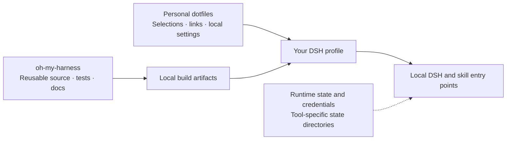

[中文](dotfiles.md) | English

# Public code, personal configuration

[← Documentation](README.en.md) · [Repository layout](architecture.en.md#why-the-directories-look-this-way)

oh-my-harness provides reusable code, tests, examples, and documentation. Dotfiles choose components, place entry points, and configure accounts and machines. Use symlinks, your own configuration manager, or manual registration. The maintainer's private repository is not required.

## Recommended dependency direction



Public code provides defaults and configuration interfaces. Personal configuration selects and combines them. Public builds and tests must not require private directories, accounts, or network services. Runtime state stays out of the source tree.

| Public repository | Personal configuration or state directories |
| --- | --- |
| Reusable plugins, skills, and shared code | Model accounts, keys, and personal preferences |
| Examples with reserved addresses and fictional accounts | Machine inventories, SSH aliases, private service addresses |
| Synthetic test inputs and public demos | Real transcripts, screenshots, and browser profiles |
| Dependencies, licenses, and build checks | Installation choices, entry-point symlinks, runtime caches |

## One source, several entry points

Keep oh-my-harness as an independent checkout or a Git submodule in your dotfiles. A submodule records the public URL and a commit. Commit public changes and the parent repository's updated submodule pointer separately.

A fictional layout:

```text
workspace/
├── oh-my-harness/              Public source
└── personal-config/
    ├── profile/               Your DSH configuration
    └── trusted-skills/        Links only to reviewed skills
```

Here, a profile link dependency can point to `../../oh-my-harness/dsh-python-repl`; trusted skill links point to the corresponding public source directories. Preserve complete skill directories and adjacent shared support. Follow each [component's instructions](components.en.md).

Avoid maintaining separate source copies in dotfiles and the public repository. Old entry points can remain as links, with fixes made in the public source. Before moving source, check profile dependencies, command and skill entry points, and running processes. A working-looking interface does not prove a path change reached the final consumer.

## Make optional integrations explicit

`dsh-use` session discovery, dispatch, receipts, and waiting work independently. Model selection can use its own `tiers.normal` and `tiers.fast` settings or an explicitly selected model. **This repository does not ship a model quota service implementation.** The `quota` command needs an additional compatible integration and returns `quota-unavailable` without a report. Missing optional data must not be presented as real usage. See [control plugin configuration](../dsh-use/README.en.md#configuration).

## Move one capability out of private configuration

Migrate a complete, verifiable capability. It should meet these criteria:

1. Build and test from a clean checkout without private plugins or unreleased shared directories.
2. Inject environment differences through explicit arguments or settings; use reserved values such as `127.0.0.1` and `example.com` in examples.
3. Document licensing, provenance, installation, removal, failures, and limits.
4. Preserve the original failure shape with fictional fixtures. Review media and Git history separately.
5. After validating the public version, replace private entry points with links and verify the final consumer loads the public source.

Credentials, real incident logs, and machine-specific settings stay private. Candidates that still need independent dependencies or live acceptance can document those gaps and ship when ready.
