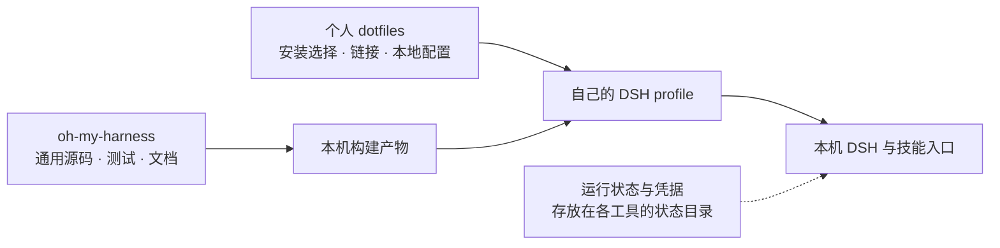

中文 | [English](dotfiles.en.md)

# 通用代码公开，个人配置自己管理

[← 文档导航](README.md) · [仓库结构](architecture.md#目录为什么这样放)

oh-my-harness 提供可复用的代码、测试、示例和说明。dotfiles 决定自己安装哪些部件、把入口放在哪、连接哪个账号和哪台机器。你可以用软链接、自己的配置管理工具，或手动登记；不需要获取维护者的私人仓库。

## 推荐的依赖方向



公开代码提供默认行为与配置接口；个人配置选择和组合它们。公开构建与测试不得依赖私人目录、账号或网络服务。运行状态不回写源码树。

| 放在公开仓库 | 放在自己的配置或状态目录 |
| --- | --- |
| 通用插件、技能和共享实现 | 模型账号、密钥、个人偏好 |
| 保留地址和虚构账号的示例 | 机器清单、SSH 别名、私人服务地址 |
| 合成测试输入与公开演示 | 会话原文、真实截图、浏览器资料 |
| 依赖清单、许可证、构建检查 | 安装选择、入口软链接、运行缓存 |

## 一份源码，多个入口

可以把 oh-my-harness 当作独立检出，也可以登记为 dotfiles 的 Git 子模块。后者只记录公开仓库地址和提交，更新时分别提交公开变更和父仓库的子模块指针。

例如，以下只是虚构布局：

```text
workspace/
├── oh-my-harness/              公开源码
└── personal-config/
    ├── profile/               自己的 DSH 配置
    └── trusted-skills/        只链接你审查过的技能
```

在这个布局下，profile 的 `link:` 依赖可指向 `../../oh-my-harness/dsh-python-repl`；可信目录里的技能链接指向公开源码对应目录。保留完整技能目录及相邻共享支持，按[部件说明](components.md)处理具体安装要求。

避免复制一份源码到 dotfiles 后在两边分别修改。旧入口可以保留为链接，维护和修复集中在公开来源。移动源码前，先核对 profile、命令入口、技能入口和正在运行的进程；路径变化不能靠界面看起来正常来验收。

## 可选集成要说清楚

`dsh-use` 的会话查看、派发、回执和等待可独立使用。模型选择可以使用插件自己的 `tiers.normal` 与 `tiers.fast` 配置，或明确指定模型。**本仓库不交付模型额度服务的实现**；`quota` 需要额外的兼容集成，缺少报告时会返回 `quota-unavailable`。可选服务缺失不应被写成已获取真实额度。详见[控制插件配置](../dsh-use/README.md#配置)。

## 从私人配置迁出一个部件

迁移的对象应是一项完整、可验证的能力。至少满足以下条件：

1. 在干净检出中能构建和测试，不需要私人插件或未发布的共享目录。
2. 环境差异通过显式参数或配置注入；示例使用 `127.0.0.1`、`example.com` 等保留值。
3. 许可与上游来源明确，安装、卸载、失败和限制都有说明。
4. 测试使用虚构输入，仍覆盖原故障的输入形状；截图和提交历史单独检查。
5. 公共版本验证通过后，把私人入口改为链接，确认最终加载的就是公开来源。

凭据、真实事件日志和机器专用配置始终留在私有边界。暂时缺少独立依赖或真实验收的候选，可以先列出缺口，成熟后再发布。
