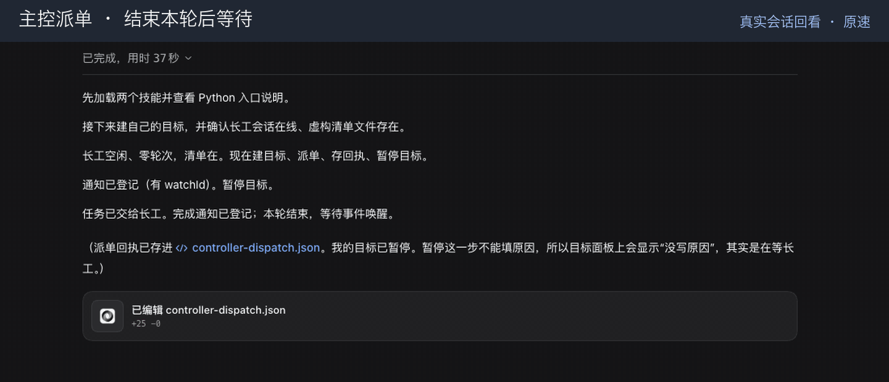

中文 | [English](README.en.md)

# dsh-control

[← 返回首页](../README.md#由哪几块组成) · [教程](../docs/dsh-control.md)

**一句话：** 从外面遥控正在运行的 DSH：开会话、派任务、等它真的做完、发通知、重启。

从同一台电脑上的另一个 AI 助手控制正在运行的 DeepSeek Harness（DSH）。插件提供私有 Unix socket 通信入口、命令行、异步 Python 接口，以及使用标准输入输出通信的 MCP 服务。它能查看和管理会话、派任务、保存发送回执、等任务做完、通知发起会话、按档位选模型，也能经 SSH 控制另一台机器上的实例。

**仅支持 macOS。** 需要 Node.js 22.19+（或 24+）、pnpm、Python 3 和 DSH 桌面应用。打开应用、重启、通知和识别机器都使用 macOS 能力。通过 SSH 启动桌面应用时，目标机器需要已登录图形桌面。


## 实际效果

下面都是真实录屏，用的是虚构数据和本地示例网页，没有登录任何账号。

**主控派活，长工干活。** 主控派单后就停下等；长工做完，主控被叫醒，自己重算一遍再验收。



## 安装

从 oh-my-harness 的源码目录构建，并保留共用的 `tooling/` 目录。离线检查入口是 `tooling/doctor-cli.mjs`；本仓库包含它的核心实现和启动检查。

```sh
cd /path/to/plugins/dsh-control
pnpm install
pnpm run check
```

在 DSH profile 的包清单中添加链接依赖和组合包：

```json
{
  "dependencies": { "dsh-control": "link:../../path/to/plugins/dsh-control" },
  "dsh": { "profile": { "bundles": ["dsh-control"] } }
}
```

把条目合进现有清单。链接路径相对于 profile，安装它的依赖时保留其他组合包。把本插件的 `bin/` 目录加入 PATH。重启 DSH 前先运行 `dsh-control doctor --json`。插件代码变更需要重启；只改 profile 不会清掉 Node 的模块缓存。

给 AI 助手使用时，通过它支持的技能目录暴露 `skills/dsh-control`，也可以加上 `skills/dsh-supervise`。保留完整目录。控制技能包含 `SKILL.md`、`PYSKILL.md`、references 和 `src/dsh_control`。支持 Python 的技能加载器从这个 `src/` 目录导入 `dsh_control` 包，再通过 `skills.dsh_control` 提供；其他助手使用命令行。不要用一份说明覆盖另一份。

## 在本机使用

本机命令不需要任何共享远程控制包。在线命令要求插件正在运行。`help` 和能力握手可以离线执行；`doctor`、`start` 和 `restart` 管理桌面应用的生命周期。

```sh
dsh-control health --json
dsh-control sessions --limit 3 --json
dsh-control pick fast --json
dsh-control new example-workspace --model provider/model --effort high --json
dsh-control send session-id 'Complete the requested change' --notify self --json
dsh-control wait session-id --since 123 --settled --json
```

使用已登记的工作区名，可以把新会话留在对应工作区分组里。也支持绝对目录。模型路径必须已存在于正在运行的 DSH 模型目录中。除了档位，也可以明确传入 `--model` 和 `--effort`。

```python
await skills.dsh_control.health()
await skills.dsh_control.sessions(limit=3)
await skills.dsh_control.pick("fast")
```

Python 结果保留命令行的 JSON、`exit_code`、`stdout` 和 `stderr`。非零结果不会被改成成功。发送后保存会话标识和起始序号；重新等待和重新发送消息是两件事。监听登记成功只证明进程已启动，不证明服务已就绪。

## 配置

在 profile 补丁中覆盖 `dsh-control` 条目。`config` 覆盖会替换组合包的整个配置块；提供机器布局时，机器和服务清单都要写。默认没有任何机器或服务。

```yaml
- id: dsh-control
  config:
    machines: []
    services: []
    tiers:
      normal: [provider/main-model]
      fast: [provider/fast-model]
    quotaFromModelPrefix: []
    readOnly: false
```

| 设置 | 默认值 | 作用 |
| --- | --- | --- |
| `readOnly` | `false` | 拒绝写命令，包括发消息、改会话、改插件和写配置。 |
| `denyNamespaces` | `[credentials, terminal, dynamicCordisRunner, account]` | 禁止访问这些内部接口分组，通用 API 调用也受限。 |
| `waitSliceMs` | `30000` | 服务端每次等待的上限，范围为 1000 到 120000 ms；命令行会分段继续等。 |
| `questionGraceMs` | `600000` | 所有界面窗口关闭后，再等待回答助手提问的时间。0 表示不延长，最大 86400000 ms。 |
| `tiers.normal` / `tiers.fast` | `[]` / `[]` | 按顺序填写 `provider/model`。没有可选的 `optional model/quota provider` 档位服务时，使用这些列表。 |
| `quotaFromModelPrefix` | `[]` | 哪些服务商的模型 ID 首段表示额度来源。例如只有配置了 `relay`，`relay/vendor/model` 才会对应到 `vendor`。 |
| `machines` | `[]` | 设置页中的远程机器清单。 |
| `services` | `[]` | 清单中机器可用的服务和操作。 |

如果 `optional model/quota provider` 提供档位，就优先用它的档位文档和保留比例；它记录的近期失败也会排除暂时停用的模型。否则使用插件自己的列表、10% 保留量和可取得的额度信息。拿不到额度报告会警告，不编造用量。两边都没有配置档位时，错误会说明两种配置方法。选择模型时不会悄悄换档。

每台机器有 `id`（SSH 别名）、`label`、`hostname`（远端 `scutil --get LocalHostName` 的值）、0 到 9 中唯一的 `slot`，以及可选的 `secondary: false`。本机不会列在远程卡片里。

每个服务有 `id`、`label` 和 1 到 55526 的 `port`。可选字段包括 `on`（机器 ID，空表示全部）、`check`（命令参数列表，退出 0 表示在线）、`open`（输出以隧道基础地址开头的网址的命令参数列表），以及 `actions`（包含 `label`、`run` 参数列表和可选 `confirm: false` 的对象）。没写 `check` 就探测端口；没写 `open` 就直接打开隧道网址。参数可以包含 `{base}`、`{port}`、`{localPort}`、`{machine}`。固定本地隧道端口为 `port + 10000 + slot`；ID 重复、slot 重复或端口冲突都会拒绝。远程命令参数的引号写法兼容 bash、zsh 和 fish。

## 跨机器命令

远程命令还需要 OpenSSH 别名、无需交互的密钥认证、两台机器上兼容的 `dsh-control`，以及可选的共享 Python 包 `agentkit/remote`。启动器会在本源码相邻的 `skills/_shared` 目录中查找 `agentkit`；可用 `DSH_CONTROL_SHARED_ROOT` 明确覆盖位置。安装远程控制技能时保留这个共享目录。远端 shell 必须能找到命令及其运行环境。

```sh
dsh-control -H alpha health --json
dsh-control hosts --json
dsh-control use alpha --json
dsh-control --local health --json
dsh-control use local --json
```

只有远端目标选择和管理才加载共享包。没有它时，远程请求会带安装提示失败；要求 JSON 时也返回结构化错误，不会改在本机执行。记住的远端目标也仍然需要远程支持；`--local` 可以明确覆盖它。命令行的 SSH 别名来自共享远程支持，设置页清单来自 `machines` 和 `services`，这是两份不同来源。

跨机器 `send --notify self` 需要明确的发起会话和兼容的能力握手。共享路由会记录远端发送回执，并在发起机器上观察完成状态。跨机器 `chat --notify self` 会在发送前拒绝。

## MCP

配置 MCP 客户端，用 `bin/dsh-control` 的绝对路径启动，并传入参数 `mcp`。这是本机标准输入输出服务：stdout 传协议消息，stderr 记日志。它不继承已经记住的远端目标。MCP 支持发现和读取已有会话、连接已有会话、创建和继续任务、回答任务提问和取消任务。不开放通用 API 写操作、全局重启、插件或配置修改。工具、状态、权限和失败恢复见 [MCP 客户端指引](skills/dsh-control/references/raycast.md)。

## dsh-supervise

随包提供的 [dsh-supervise 技能](skills/dsh-supervise/SKILL.md)协调一个主控会话和一个执行会话。主控设定任务并验收阶段结果；执行会话按明确清单做事。主控等待时停下来，收到完成通知或异常通知后再接着处理，避免反复调用模型只为查进度。

通过已有的本地主控会话登记持久看守任务，使用实际技能路径：

```sh
dsh-control monitor LEAD_SESSION --cwd /path/to/project --label 'worker watchdog' --quiet \
  --command 'python3 -I /path/to/plugins/dsh-control/skills/dsh-supervise/scripts/watchdog.py --lead LEAD_SESSION --worker WORKER_SESSION'
```

看守任务会通知停滞、服务中断、恢复和检查器错误；重复诊断写入 stderr。要监督远程执行会话，在看守命令内加 `--host alpha`。监督结束后停止返回的监听任务。这个流程既支持明确选择模型和推理等级，也支持档位。

## 安全和结果判断

- 控制服务监听 `$DSH_HOME/dsh-control/dsh.sock`，不是 TCP 端口。所在目录权限为 0700，socket 为 0600。它信任同一系统用户运行的程序，没有额外的本地令牌边界。
- 设置页接口使用 DSH 已认证的网页 API。SSH 隧道只绑定本机回环地址。打开返回的网址不会把其中的登录令牌暴露给设置页。
- `readOnly` 和 `denyNamespaces` 约束插件命令。重启等生命周期命令也会停止正在进行的工作；使用时遵守技能中的授权和重启规则。
- 发送回执只证明已接收，不证明任务完成。`wait --settled` 还会检查排队工作、后台任务、子代理和自动续跑目标。发送结果不明时，先查清再决定是否重试。
- 日志记录命令名、耗时和结果，不记消息正文。发消息、改配置、取消工作和发送外部通知仍需用户授权。
- `DSH_HOME` 选择 DSH 状态目录；`DSH_CONTROL_SOCKET` 覆盖命令行 socket 路径，`DSH_APP` 指定桌面应用。它们不会把本机 socket 变成远程服务。

## 开发

```sh
pnpm run check
python3 -I skills/dsh-supervise/scripts/test_watchdog.py
```

检查包括类型检查、构建、Node 测试和 Python 接口测试。Shell 引号测试覆盖 bash、zsh 和 fish。更详细的生命周期与协议约束见 [AGENTS.md](AGENTS.md)。按 [MIT](LICENSE) 许可发布。
