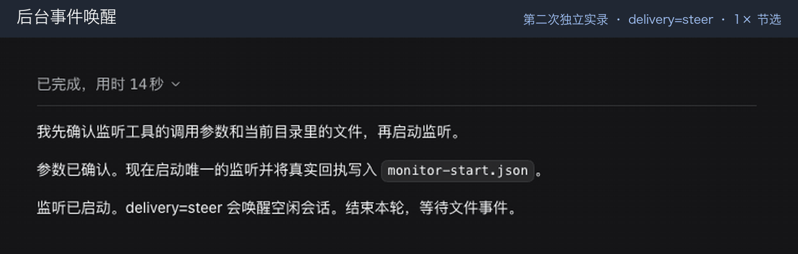

中文 | [English](README.en.md)

# dsh-monitor

[← 返回首页](../README.md#由哪几块组成) · [教程](../docs/dsh-monitor.md)

**一句话：** 盯着一个一直在跑的程序，它每打出一行，就送进会话叫醒助手。

把一个持续运行的程序输出的每一行 stdout 送进 DeepSeek Harness（DSH）的助手会话。适合跟随日志、看构建状态、监听文件变化和其他事件流。监听任务也会列在 DSH 的后台任务列表中。


## 实际效果

下面都是真实录屏，用的是虚构数据和本地示例网页，没有登录任何账号。

**后台事件叫醒会话。** 文件一写进来，空闲的会话就被叫醒，核对内容后停止监听。



## 使用条件和安装

DSH 需要提供兼容的 jobs、subprocess、tools、agents 和 system-prompt 服务。开发依赖面向 DSH 0.2.2-rc.1。需要 Node.js `^22.19.0 || >=24.0.0`、pnpm 和 Bash。结束进程组使用 POSIX 信号，这个实现不支持 Windows。设置卡片需要 DSH 网页界面。

保留所在仓库中与插件相邻的共用 `tooling/` 目录。不能只拿这个源码目录单独构建。在本目录执行：

```sh
pnpm install --frozen-lockfile
pnpm run check
```

在 DSH profile 的包清单中合入链接依赖和组合包，保留已有条目：

```json
{
  "dependencies": {
    "dsh-monitor": "link:../../path/to/oh-my-harness/dsh-monitor"
  },
  "dsh": {
    "profile": {
      "bundles": ["dsh-monitor"]
    }
  }
}
```

把示例链接改成相对于你的 profile 目录的路径。使用 DSH 安装所支持的 pnpm 安装 profile 依赖，再重启 DSH。组合包已经登记 `monitor`，不要重复插入。安装环境提供启动检查器时，重启前先校验 profile。

## 工具和行为

| 工具 | 作用 |
| --- | --- |
| `monitor` | 启动命令，把 stdout 的各行送给所属会话。 |
| `monitor_output` | 回看近期输出，不消费记录。 |
| `monitor_list` | 列出调用者的监听任务，运行中的排在前面。 |
| `monitor_kill` | 停止监听及其进程组。 |

工具参数示例：

```json
{
  "command": "tail -f ./example.log",
  "description": "Watch example events",
  "persistent": true,
  "restart": "on-failure",
  "delivery": "inject",
  "ignore_stdout_lines": ["heartbeat"]
}
```

在包含示例日志的目录执行，或用绝对路径指定 `workdir`。`delivery: "steer"` 会叫醒空闲助手，助手忙碌时则在下一步边界送入。`inject` 只把消息排进上下文，不叫醒助手；`followup` 安排单独一轮。没有传值时，跟随插件当前设置。明确指定的投递方式和忽略行会随这条监听保留，进程重启后也不变。

`ignore_stdout_lines` 只排除完全相同的完整 stdout 行的自动投递。被忽略的行仍可在留存输出中查到。stderr 单独记日志，失败时带入诊断，不会被当成 stdout 事件转发。长行和输出历史都有明确上限。

监听默认持久运行，没有默认寿命上限。`persistent: false` 的监听会在助手下一次空闲时停止，即使命令还没执行完。`timeout_ms` 限制总寿命，不是多久没输出就停止。明确停止、超时、会话销毁或插件销毁都不会触发进程重拉。`restart: "on-failure"` 在异常退出后按逐次延长的间隔重试；`always` 也会重试正常退出；`never` 在退出时结束任务。

配合重启控制器发出的暂停和恢复事件，持久监听可以先保存，再在 DSH 重启后重新拉起。重新拉起会产生新的任务 ID。中断期间的输出无法由本插件补回，助手必须检查原始来源。插件没有实现持久事件队列。

命令在宿主环境里以宿主权限执行。把事件输出当作数据，只运行你信任的命令。

## 配置

在 profile 补丁里覆盖现有条目，或使用监听设置卡片：

```yaml
- id: monitor
  config:
    delivery: inject
    coalesceMs: 200
    restart: on-failure
```

设置会即时生效，无需重新挂载插件。每条监听显式传入的参数会覆盖对应默认值。

| 设置 | 默认值 | 作用 |
| --- | --- | --- |
| `delivery` | `steer` | 通知投递方式。 |
| `coalesceMs` | `200` | 投递前合并输出的毫秒数。 |
| `maxLinesPerNotice` | `50` | 每条通知最多带多少行。 |
| `maxBytesPerNotice` | `32768` | 每条通知的目标字节额度。 |
| `maxLineBytes` | `8192` | 单行最多保留多少字节，超出时明确标记截断。 |
| `historyLines` | `2000` | 为回看工具保留的近期行数。 |
| `stderrTailLines` | `20` | 结束时带上的诊断行数。 |
| `defaultTimeoutMs` | `0` | 默认寿命上限；零表示不限。 |
| `maxTimeoutMs` | `86400000` | 显式寿命上限的最大值。 |
| `graceMs` | `3000` | 强制结束前的宽限时间。 |
| `restart` | `never` | 可选 `never`、`on-failure` 或 `always`。 |
| `restartDelayMs` | `1000` | 第一次重拉前的等待时间。 |
| `restartMaxDelayMs` | `60000` | 重拉等待时间的上限。 |
| `restartLimit` | `0` | 连续重拉的次数上限；零表示不限。 |
| `restartResetMs` | `60000` | 一次正常运行达到这个时长后，重置重拉间隔；零表示不重置。 |
| `logDir` | `""` | 空值使用 `$DSH_HOME/monitor-logs`。 |

禁用组合包条目时，覆盖 `id: monitor` 并设 `disabled: true`。

## 开发和测试

```sh
pnpm run typecheck
pnpm run build
pnpm run test
# All three:
pnpm run check
```

测试覆盖按行解码、输出额度、失败诊断、投递方式、取消、重启恢复，以及真实本地任务和子进程的集成。使用隔离的 DSH 状态目录。已安装宿主的完成通知检查会从 `DSH_APP_ASAR` 或 macOS 标准安装路径读取本机应用归档；归档不存在就跳过。有一项检查标为 TODO，因为宿主不支持按任务覆盖完成通知的投递方式：`delivery: "inject"` 只控制监听自己的通知，通用任务完成通知仍跟随宿主设置。这些检查不能代替真实助手或界面的验收。

## 许可

MIT。见 [LICENSE](LICENSE)。
