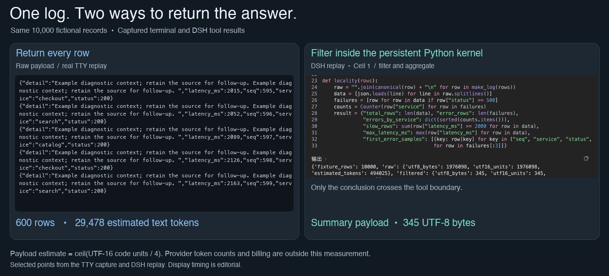
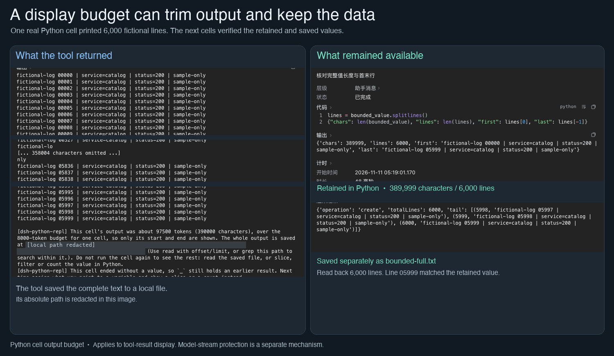

[中文](README.md) | English

# dsh-python-repl

[← oh-my-harness](../README.en.md#components) · [Tutorial](../docs/dsh-python-repl.en.md)

**In short:** Lets the assistant do its work in Python. One step can call many tools; large data stays in the program and only the checked conclusion goes into the chat.

Persistent Python cells for [DeepSeek Harness](https://github.com/deepseek-ai/deepseek-harness). The plugin replaces the built-in TypeScript PTC runtime behind `run_code` with a Python process for each session.


## See it work

These are real recordings using fictional data and local example pages. No accounts are signed in.

**One log, two ways to answer.** Left: all 10,000 log records go to the model. Right: Python computes first and returns only the conclusion.



**Long output shows only the head and tail**, while the full text stays in Python. A single print contains 6000 lines.



## What it provides

- Top-level `await`, expression results, and variables and functions shared across cells.
- Namespace snapshots that can restore serializable state after a kernel or Harness restart. Files, connections, processes, and running tasks are not restored as live resources; missing state is reported.
- Harness tools through `tools`, with `read`, `write`, `edit`, `bash`, `glob`, and `grep` also available as fixed helpers. Tool calls use the current cell's Harness permissions.
- Python functions supplied by trusted skills, discovered before startup and imported before the first user cell. One failing skill does not prevent the others from loading.
- A kernel tab for inspecting names and explicitly controlling the session kernel, bounded output with retrievable full text, and background Python work through `repl.background`.

## How this differs from DSH's built-in code mode and Prime Agent

All three do the same kind of thing: the model writes a piece of code and calls tools from it. They differ in the language, in whether anything survives after the code runs, and in who is in charge.

- **DSH's built-in code mode** is officially called PTC (programmatic tool calling). The model writes TypeScript and calls tools from it. By default every call starts a new Node process and closes it afterwards, so whatever one call computed is gone for the next. DSH can also keep memory between calls, but that is lost when DSH restarts.
- **[Prime Agent](https://github.com/PrimeIntellect-ai/prime-agent)** is a standalone open-source AI assistant from Prime Intellect. Its core idea is to give the model a Python environment that stays open, with variables saved as snapshots and restored after a restart. Reading files, running commands and starting subagents are all done by writing code in that Python environment, and it can connect to MCP servers. But it is a complete assistant with its own conversation loop, so it cannot be dropped into DSH.
- **dsh-python-repl** takes Prime's Python kernel, puts it inside DSH, and replaces the built-in TypeScript code mode. DSH still runs the conversation, decides which tool calls need approval, and starts subagents. Prime contributes only the always-open Python environment.

| | DSH built-in code mode | Prime Agent | dsh-python-repl |
| --- | --- | --- | --- |
| What it is | Built into DSH | A standalone AI assistant | A DSH plugin |
| What the model writes | TypeScript | Python | Python |
| Is the previous step's variable still there? | Not by default. With memory kept on, it still does not survive a DSH restart | Yes, restored from a snapshot after a restart | Yes, restored from a snapshot after DSH restarts |
| Who owns the conversation, permissions and approvals | DSH | Prime itself | DSH |
| Which tools it can call | DSH's tools | Prime's own files, commands, subagents and MCP connections, all called from Python | DSH's tools plus trusted Python skills, such as the browser, desktop and remote tools in this repository |

**What it takes from Prime.** Only the Python kernel from Prime's runtime: `rlm/repl.py` and its instructions. Both files sit unchanged in [`vendor/prime/`](vendor/prime/); their source and hashes are recorded in [PROVENANCE.md](vendor/PROVENANCE.md). Prime's conversation loop, tools and installer are not installed.

**Why not write one from scratch.** I had already written my own Python kernel for DSH. It was feature-complete at close to ten thousand lines of code and tests, and it needed its own process pool and a virtual environment per session. That was too much to maintain, so I archived it. Prime's kernel already solves and tests the hard parts, persistent variables and snapshot restore, so borrowing it left me with only the bridge to DSH to write.

**What it turns off.** The bundle turns off DSH's built-in TypeScript code mode and the workflow feature that depends on it, including the matching entries in the standard and creation presets. To run several subagents from Python, use `repl.agent`.

## Requirements and supported platforms

Supported and tested on **macOS only**. Other platforms are not validated. The runtime uses POSIX process groups and signals for kernel cleanup.

- DeepSeek Harness `>=0.2.2-rc.1` with PTC tools enabled.
- Node.js `^22.19.0 || >=24.0.0`, pnpm, and [uv](https://docs.astral.sh/uv/).
- Python `>=3.11`; the default is uv-managed **3.14**. The pinned snapshot dependency cannot fully serialize functions and classes on Python 3.15.

The first kernel startup may download its Python version and install dependencies into a dedicated virtual environment. Later startups reuse it when its interpreter and package list match.

## Install from this repository

Build from the oh-my-harness checkout, retaining `dsh-python-repl/` and its adjacent `tooling/` directory. The shared build and content-manifest utilities live in `tooling/`. Building a copied plugin directory alone is not supported.

```sh
cd dsh-python-repl
pnpm install --frozen-lockfile
pnpm run check
```

In your Harness profile, add a local link dependency and register the bundle. Adapt the relative path to your checkout:

```json
{
  "dependencies": {
    "dsh-python-repl": "link:../../plugins/dsh-python-repl"
  },
  "dsh": {
    "profile": {
      "bundles": ["dsh-python-repl"]
    }
  }
}
```

Merge these entries into the existing profile rather than replacing it. Install profile dependencies using your Harness installation's pnpm, then restart Harness. Do not also insert another `python-repl` row: the bundle already provides it. Override options with the existing loader id:

```yaml
- id: python-repl
  config:
    skillRoots:
      - "~/trusted-skills"
    skillRenames:
      old_reader: demo_reader
```

For removal, disable `python-repl` and re-enable `ptc-runtime`. Re-enable the host workflow entries if you want TypeScript workflows again.

## Configuration

Options are stored under the `python-repl` loader id. The plugin settings card exposes the options below except `skillRenames`, which is edited in the profile. Most changes apply to **new session kernels**; existing kernels retain their interpreter, imports, and state. `maxCellTimeoutMs` is read per call; `residentTools` controls prompt disclosure.

| Option | Default | Meaning |
| --- | --- | --- |
| `python` | `"3.14"` | uv-managed version, command on the host PATH, or interpreter path; `~` expands. |
| `skillRoots` | `[]` | Trusted Python skill directories; relative paths resolve against the host startup directory. |
| `projectSkillRoots` | `[".agents/skills"]` | Skill directories relative to the nearest repository root, or session directory outside a repository. A project skill wins over a configured one with the same name. Set `[]` to disable project skill discovery. |
| `skillRenames` | `{}` | Old import names mapped to current import names, only for missing-name suggestions. No aliases are created, and only available skills are suggested. |
| `residentTools` | See below | Extra Harness tools whose full contracts appear beside the six fixed helpers. Other tools have summaries and on-demand descriptions. |
| `maxFrameBytes` | `67108864` | Maximum size of one kernel protocol frame. Oversized frames retire the kernel. |
| `startupTimeoutMs` | `30000` | Deadline for handshake and initialization, including skill imports and restore. |
| `teardownGraceMs` | `5000` | Host-side deadline for end-of-cell cleanup. |
| `interruptGraceMs` | `5000` | Grace period when a cancelled cell still runs as the next cell arrives; expiry kills the kernel. |
| `toolCallTimeoutMs` | `0` | Optional bridge reply deadline. Zero follows Harness tool lifetimes, including human waits. |
| `maxCellOutputTokens` | `8000` | Estimated cell output budget. Full overflow output goes to the Harness spill store; zero disables the limit. |
| `maxCellTimeoutMs` | `86400000` | Maximum cell duration, including tool and approval waits. A smaller call-level `timeoutMs` wins. |
| `cellWaitMs` | `5000` | Maximum foreground wait for a bash command or job before it continues in the background. Zero disables this cap. A subagent session waits at least 10 minutes: when a subagent's turn ends, DSH stops its background jobs without a notice, so it has to wait for results in a cell. |
| `archiveAfterCells` | `100` | Archive unpinned names after this many unused cells; using them restores them automatically. Zero disables archiving. |
| `deleteAfterCells` | `200` | Delete unpinned names after this many unused cells. Zero disables deletion. |
| `idleKernelMinutes` | `60` | Reclaim fully recoverable idle kernels when no tasks, threads, or child processes are active. Zero disables reclaim. |

The default resident tools are `job_output`, `job_kill`, `ask_user_question`, `read_image`, `web_search`, `present`, `todo_write`, `interrupt_agent`, and `update_goal`.

Runtime state lives below `DSH_HOME/plugins/python-repl/`. Each session has its own snapshot and execution history. Kernel environments are shared by Python minor version; project dependencies still belong in the project's own environment.

## Python skills

Each trusted skill has a standard `SKILL.md` identity and a Python package under `src/<import_name>/`. When present, `PYSKILL.md` supplies Python instructions; otherwise `SKILL.md` is used. Invalid Python instructions are reported without silently switching documents. Import names replace hyphens with underscores. Skills are available through `skills.<import_name>`; use `await skills.list()` and `await skills.describe("demo_reader")` to discover their functions and instructions.

Do not use `import skills.demo_reader` or install a package named `skills`. `skills` is already a bound namespace and needs no import; `import skills` returns that same namespace. Documentation-only skills remain accessible through the Harness `skill` tool.

## Trust and cancellation

**This is a trusted Python environment, not a sandbox.** Python can access the host filesystem, network, and processes independently of Harness tools. Importing a skill executes its top-level code. Trust every configured skill directory and every repository opened with project skill discovery enabled.

Harness tool calls retain Harness approval and policy checks. A cell losing its tool authorization does not remove Python's host capabilities. Cancellation delivers `asyncio.CancelledError` and preserves the kernel when possible. Completed external effects are not undone or replayed; threads and detached processes may continue. Use managed Harness background jobs for services that must outlive a kernel.

## Development and attribution

`pnpm run check` runs TypeScript checking, the build, TypeScript tests, and Python tests. `pnpm run test:py` runs the Python suite separately. Tests use isolated Harness state; the snapshot integration fixture creates a dedicated uv-managed test environment when needed.

Our code is MIT licensed under [LICENSE](LICENSE). Unmodified Prime Agent files retain their original license and attribution in [vendor/prime/LICENSE](vendor/prime/LICENSE). Exact upstream sources and hashes are recorded in [vendor/PROVENANCE.md](vendor/PROVENANCE.md). Do not edit vendored files.