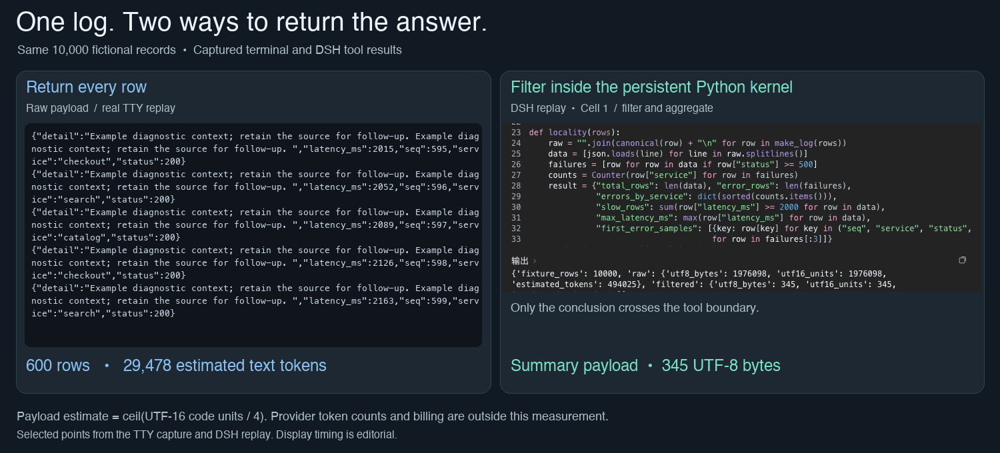
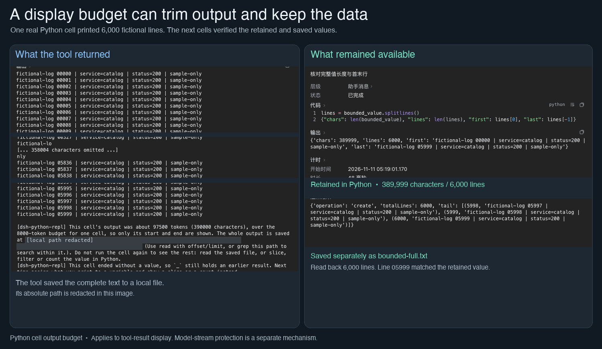

中文 | [English](README.en.md)

# dsh-python-repl

[← 返回首页](../README.md#由哪几块组成) · [教程](../docs/dsh-python-repl.md)

**一句话：** 让助手写 Python 来做事。一次可以调用很多工具，大块数据留在程序里，只把算好的结论放进对话。

给 [DeepSeek Harness](https://github.com/deepseek-ai/deepseek-harness) 使用的 Python 代码执行插件。每个会话都有一个持续运行的 Python 进程，多次调用可以接着用前面的变量。它把 `run_code` 原来的 TypeScript 程序化工具调用（PTC）运行环境换成 Python。


## 实际效果

下面都是真实录屏，用的是虚构数据和本地示例网页，没有登录任何账号。

**同一份日志，两种回法。** 左边把 1 万条日志整段交给模型；右边在 Python 里先算好，只回结论。



**长输出只显示首尾。** 一次打印 6000 行时，对话里只显示开头和结尾，完整内容仍留在 Python 里。



## 能做什么

- 直接使用顶层 `await`，显示表达式的结果。变量和函数可以跨代码格复用。
- 把能保存的状态写成命名空间快照。Python 内核或 DSH 重启后可以恢复。文件、连接、进程和正在运行的任务不能恢复成原来的活资源；缺了什么会明确报告。
- 通过 `tools` 调用 DSH 工具。`read`、`write`、`edit`、`bash`、`glob`、`grep` 也有固定的快捷入口。每次工具调用都使用当前代码格的 DSH 权限。
- 启动前发现可信技能，在第一个用户代码格执行前导入它们提供的 Python 函数。一个技能导入失败，不影响其他技能加载。
- 在内核标签页查看名字，明确控制当前会话的 Python 内核。输出显示有上限，但可以取回完整文本。需要后台执行的 Python 工作可用 `repl.background`。

DSH 自带的代码模式运行 TypeScript。本插件运行 Python，并在两次调用之间保留会话的解释器。底层使用上游 Prime Agent 的 REPL 核心，再接上 DSH 工具桥；不安装 Prime 的 agent 运行环境或它自带的工具入口。组合包会关闭原有的 TypeScript PTC 后端和依赖它的工作流引擎，也会关闭标准模式和创造模式中的对应工作流条目。Python 仍可通过 `repl.agent` 组织子代理。

## 使用条件和支持平台

目前**只在 macOS 上支持并测试过**。其他平台尚未验证。运行环境使用 POSIX 进程组和信号来清理内核。

- DeepSeek Harness `>=0.2.2-rc.1`，并启用 PTC 工具。
- Node.js `^22.19.0 || >=24.0.0`、pnpm 和 [uv](https://docs.astral.sh/uv/)。
- Python `>=3.11`，默认使用 uv 管理的 **3.14**。当前固定的快照依赖在 Python 3.15 上无法完整保存函数和类。

首次启动内核时可能下载对应的 Python，并把依赖装进专用虚拟环境。后续启动时，解释器和依赖清单一致就会复用。

## 从本仓库安装

从 oh-my-harness 的源码目录构建。保留 `dsh-python-repl/` 及其相邻的 `tooling/`。共用的构建和内容清单工具都在 `tooling/` 中。不支持只复制一个插件目录来构建。

```sh
cd dsh-python-repl
pnpm install --frozen-lockfile
pnpm run check
```

在 DSH 的 profile 配置里添加本地链接依赖，并登记组合包。下面的相对路径需要按你的源码位置调整：

```json
{
  "dependencies": {
    "dsh-python-repl": "link:../../plugins/dsh-python-repl"
  },
  "dsh": {
    "profile": {
      "bundles": ["dsh-python-repl"]
    }
  }
}
```

把这些条目合进现有 profile，不要整份替换。使用 DSH 安装所配的 pnpm 安装 profile 依赖，再重启 DSH。不要再插入一条 `python-repl`：组合包已经提供了。覆盖选项时使用现有的加载条目 id：

```yaml
- id: python-repl
  config:
    skillRoots:
      - "~/trusted-skills"
    skillRenames:
      old_reader: demo_reader
```

移除时禁用 `python-repl`，重新启用 `ptc-runtime`。如果还需要 TypeScript 工作流，也要重新启用宿主的工作流条目。

## 配置

选项放在 `python-repl` 加载条目下。插件设置卡片提供下表中的选项，但 `skillRenames` 需要在 profile 中编辑。大多数改动只影响**新建的会话内核**；已有内核保留原解释器、导入内容和状态。`maxCellTimeoutMs` 每次调用时读取；`residentTools` 决定哪些工具的完整说明常驻在提示中。

| 选项 | 默认值 | 含义 |
| --- | --- | --- |
| `python` | `"3.14"` | uv 管理的版本号、宿主 PATH 上的命令名，或解释器路径。会展开 `~`。 |
| `skillRoots` | `[]` | 可信 Python 技能目录。相对路径以宿主启动目录为准。 |
| `projectSkillRoots` | `[".agents/skills"]` | 相对于最近仓库根目录的技能目录；不在仓库中时，相对于会话目录。同名时项目技能优先于配置中的技能。设为 `[]` 可关闭项目技能发现。 |
| `skillRenames` | `{}` | 旧导入名到当前导入名的对应关系，只用于缺失名字时的建议。不创建别名，也只建议可用技能。 |
| `residentTools` | 见下文 | 除六个固定快捷工具外，完整调用说明也常驻的 DSH 工具。其他工具只显示摘要，需要时再查详细说明。 |
| `maxFrameBytes` | `67108864` | 内核通信中单帧的最大大小。超限会停用该内核。 |
| `startupTimeoutMs` | `30000` | 握手和初始化的等待上限，包含技能导入和状态恢复。 |
| `teardownGraceMs` | `5000` | 宿主等待代码格结束清理的时间上限。 |
| `interruptGraceMs` | `5000` | 已取消的代码格在下一格到来时仍未停止，可再等多久；超过就结束内核。 |
| `toolCallTimeoutMs` | `0` | 可选的工具桥回复等待上限。零表示跟随 DSH 工具的生命周期，包括等待用户。 |
| `maxCellOutputTokens` | `8000` | 每格输出的估算展示额度。超出部分的全文存入 DSH 溢出存储；零表示不限制。 |
| `maxCellTimeoutMs` | `86400000` | 单格最长执行时间，包含工具和审批等待。调用时传入更小的 `timeoutMs`，以更小值为准。 |
| `cellWaitMs` | `5000` | 前台等待 Bash 命令或任务的最长时间，之后转后台继续。零表示关闭这个上限。 |
| `archiveAfterCells` | `100` | 未固定的名字连续多少格没使用后归档。再次使用会自动恢复。零表示不归档。 |
| `deleteAfterCells` | `200` | 名字连续多少格没使用后删除。零表示不删除。 |
| `idleKernelMinutes` | `60` | 没有任务、线程或子进程在运行，且状态能完整恢复时，回收闲置内核的等待时间。零表示不回收。 |

默认常驻的额外工具是 `job_output`、`job_kill`、`ask_user_question`、`read_image`、`web_search`、`present`、`todo_write`、`interrupt_agent` 和 `update_goal`。

运行状态保存在 `DSH_HOME/plugins/python-repl/` 下。每个会话各有自己的快照和执行历史。内核环境按 Python 小版本共享；项目依赖仍应放在项目自己的环境里。

## Python 技能

每个可信技能都有标准的 `SKILL.md` 身份说明，以及 `src/<import_name>/` 下的 Python 包。如果存在 `PYSKILL.md`，就用它提供 Python 使用说明；否则使用 `SKILL.md`。Python 说明无效时会报告错误，不会悄悄改读另一个文件。导入名中的连字符会换成下划线。通过 `skills.<import_name>` 使用技能；用 `await skills.list()` 和 `await skills.describe("demo_reader")` 查函数和说明。

不要执行 `import skills.demo_reader`，也不要安装名叫 `skills` 的包。`skills` 已经是绑定好的命名空间。只有文档、没有 Python 入口的技能，仍通过 DSH 的 `skill` 工具使用。

## 信任和取消

**这是运行可信 Python 的环境，不是沙箱。** Python 可以独立于 DSH 工具访问宿主文件、网络和进程。导入技能时会执行它的顶层代码。配置的每个技能目录，以及启用项目技能发现后打开的每个仓库，都必须可信。

DSH 工具调用仍经过 DSH 的审批和规则检查。代码格失去工具授权，不会收回 Python 本身的系统能力。取消时传入 `asyncio.CancelledError`，并在可能时保留内核。已发生的外部动作不会撤销，也不会自动重放；线程和脱离内核的进程可能继续运行。需要比内核活得更久的服务，应使用 DSH 管理的后台任务。

## 开发和来源

`pnpm run check` 会跑 TypeScript 检查、构建、TypeScript 测试和 Python 测试。`pnpm run test:py` 可单独跑 Python 测试。测试使用隔离的 DSH 状态；快照集成测试需要时会创建专用的 uv 测试环境。

本项目代码按 [LICENSE](LICENSE) 中的 MIT 许可发布。未改动的 Prime Agent 文件保留 [vendor/prime/LICENSE](vendor/prime/LICENSE) 中的原许可和署名。上游来源和精确哈希记录在 [vendor/PROVENANCE.md](vendor/PROVENANCE.md)。不要修改 vendor 文件。
