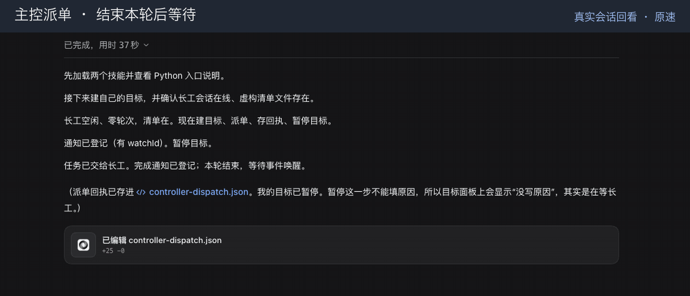

[中文](README.md) | English

# dsh-use

[← oh-my-harness](../README.en.md#components) · [Tutorial](../docs/dsh-use.en.md)

**In short:** Remote-controls a running DSH: open sessions, hand out tasks, wait until they are really done, send notifications, restart.

Control a running DeepSeek Harness (DSH) instance from another local agent. The plugin exposes a private Unix socket, a CLI, an asynchronous Python API, and an MCP stdio server. It can inspect and manage sessions, dispatch work, preserve send receipts, wait for completion, notify the originating session, select models by tier, and operate remote instances through SSH.

**Platform: macOS only.** Node.js 22.19+ (or 24+), pnpm, Python 3, and the DSH desktop app are required. App launch, restart, notifications, and machine identification use macOS facilities. A graphical login is required when starting the desktop app through SSH.


## See it work

These are real recordings using fictional data and local example pages. No accounts are signed in.

**A lead hands out work; a worker does it.** The lead dispatches and stops; when the worker finishes, the lead wakes up, recomputes the result, and accepts it.



## Install

Build from the oh-my-harness checkout, retaining its shared `tooling/` directory. The offline checker is `tooling/doctor-cli.mjs`; its core and startup probes are included in this repository.

```sh
cd /path/to/plugins/dsh-use
pnpm install
pnpm run check
```

In the DSH profile's package manifest, add a linked dependency and the bundle:

```json
{
  "dependencies": { "dsh-use": "link:../../path/to/plugins/dsh-use" },
  "dsh": { "profile": { "bundles": ["dsh-use"] } }
}
```

Merge these entries with the existing manifest. Resolve the link relative to the profile, install its dependencies, and retain the profile's other bundles. Add this plugin's `bin/` directory to PATH. Run `dsh-use doctor --json` before restarting DSH. Changed plugin code requires a restart; a profile change alone does not clear Node's module cache.

For agents, expose `skills/dsh-use` and optionally `skills/dsh-supervise` through the agent's supported skill directories. Preserve the complete directories. The control skill includes `SKILL.md`, `PYSKILL.md`, references, and `src/dsh_use`. A Python skill loader imports the `dsh_use` package from that `src/` directory and makes it available as `skills.dsh_use`; other agents use the CLI. Do not duplicate one instruction document over the other.

## Local use

Local commands work without any shared remote-control package. Online commands require the plugin to be running. `help` and the capability handshake can run offline; `doctor`, `start`, and `restart` manage the desktop application's lifecycle.

```sh
dsh-use health --json
dsh-use sessions --limit 3 --json
dsh-use pick fast --json
dsh-use new example-workspace --model provider/model --effort high --json
dsh-use send session-id 'Complete the requested change' --notify self --json
dsh-use wait session-id --since 123 --settled --json
```

Use a registered workspace name to keep a new session in its workspace group. Absolute directories are also supported. A model route must exist in the running DSH model catalog. An explicit `--model` and `--effort` can be used instead of a tier.

```python
await skills.dsh_use.health()
await skills.dsh_use.sessions(limit=3)
await skills.dsh_use.pick("fast")
```

Python results retain the CLI JSON, `exit_code`, `stdout`, and `stderr`. A nonzero result is not converted into a successful call. After a send, preserve its session identifier and starting sequence; retrying a wait is different from resending a message. A successful monitor registration means the process started, not that its service is ready.

## Configuration

Override the `dsh-use` entry in the profile patch. A `config` override replaces the bundle's configuration block: include both machine and service lists when supplying a layout. Defaults contain no machines or services.

```yaml
- id: dsh-use
  config:
    machines: []
    services: []
    tiers:
      normal: [provider/main-model]
      fast: [provider/fast-model]
    quotaFromModelPrefix: []
    readOnly: false
```

| Setting | Default | Behavior |
| --- | --- | --- |
| `readOnly` | `false` | Reject commands that write, including message sends, session changes, plugin changes, and configuration writes. |
| `denyNamespaces` | `[credentials, terminal, dynamicCordisRunner, account]` | Block these internal API namespaces, including generic API calls. |
| `waitSliceMs` | `30000` | Maximum server wait slice, from 1000 to 120000 ms; the CLI continues waiting in slices. |
| `questionGraceMs` | `600000` | Grace period for answering agent questions after all UI windows close; 0 disables the extension, maximum 86400000 ms. |
| `tiers.normal` / `tiers.fast` | `[]` / `[]` | Ordered `provider/model` lists used when the optional `optional model/quota provider` tier service is absent. |
| `quotaFromModelPrefix` | `[]` | Provider names whose model ID's first segment identifies its quota source, for example `relay/vendor/model` maps to `vendor` only if `relay` is configured. |
| `machines` | `[]` | Remote machine inventory for the settings page. |
| `services` | `[]` | Services and actions available on inventory machines. |

If `optional model/quota provider` supplies tiers, its tier document and reserve percentage take precedence; its recent-failure records also exclude temporarily paused models. Otherwise the plugin uses its own lists, a 10% reserve, and available quota information. Missing quota reports produce warnings, not invented usage data. If neither source configures tiers, the error explains both configuration options. Selection never silently switches tiers.

Each machine has `id` (SSH alias), `label`, `hostname` (the remote `scutil --get LocalHostName` value), unique `slot` from 0 to 9, and optional `secondary: false`. The local machine is omitted from remote cards.

Each service has `id`, `label`, and `port` from 1 to 55526. Optional fields are `on` (machine IDs; empty means all), `check` (argv; exit 0 means online), `open` (argv producing a URL beginning with the tunnel base), and `actions` (objects with `label`, `run` argv, and optional `confirm: false`). With no `check`, the port is probed; with no `open`, the tunnel URL opens directly. Arguments can contain `{base}`, `{port}`, `{localPort}`, and `{machine}` placeholders. Fixed local tunnel ports are `port + 10000 + slot`; duplicate IDs, slots, and colliding ports are rejected. Remote command arguments use quoting compatible with bash, zsh, and fish.

## Cross-machine commands

Remote CLI routing additionally requires OpenSSH aliases, noninteractive key authentication, compatible `dsh-use` installations on both machines, and the optional shared Python package `agentkit/remote`. The launcher discovers this checkout’s adjacent `skills/_shared` directory containing `agentkit`; `DSH_USE_SHARED_ROOT` explicitly overrides that location. Keep this shared directory when installing the remote-control skills. The remote shell must find the command and its runtimes.

```sh
dsh-use -H alpha health --json
dsh-use hosts --json
dsh-use use alpha --json
dsh-use --local health --json
dsh-use use local --json
```

Only remote target selection and management load that shared package. Without it, remote requests fail with an installation hint and structured JSON when requested; they never execute on the local machine. A remembered remote target still requires remote support; `--local` explicitly overrides it. CLI SSH aliases come from shared remote support, while the settings-page inventory comes from `machines` and `services`; these are distinct sources.

Cross-machine `send --notify self` requires a session origin and compatible capability handshakes. The shared router records the remote send receipt and watches for completion on the originating machine. Cross-machine `chat --notify self` is rejected before sending.

## MCP

Configure an MCP client to start the absolute path to `bin/dsh-use` with argument `mcp`. It is a local stdio server: stdout carries protocol messages and stderr carries logs. It does not inherit a remembered remote target. MCP supports discovering and reading existing sessions, attaching an existing session, creating and continuing tasks, answering task questions, and cancellation. It does not expose generic API writes, global restarts, or plugin/configuration changes. See [the MCP client guide](skills/dsh-use/references/raycast.md) for tools, state, permissions, and failure recovery.

## dsh-supervise

The bundled [dsh-supervise skill](skills/dsh-supervise/SKILL.md) coordinates a lead session and a worker session. The lead sets the task and checks milestones; the worker carries out an explicit checklist. The lead pauses while waiting and receives completion or exceptional-state notices, avoiding repeated model calls just to poll progress.

Register a persistent watchdog through an existing local lead session, using the actual skill path:

```sh
dsh-use monitor LEAD_SESSION --cwd /path/to/project --label 'worker watchdog' --quiet \
  --command 'python3 -I /path/to/plugins/dsh-use/skills/dsh-supervise/scripts/watchdog.py --lead LEAD_SESSION --worker WORKER_SESSION'
```

The watchdog sends notices for stalls, outages, recovery, and checker errors; repeated diagnostics go to stderr. Add `--host alpha` inside the watchdog command for a remote worker. Stop the returned monitor when supervision ends. The workflow supports direct model/effort selection as well as tiers.

## Security and results

- The control server listens on `$DSH_HOME/dsh-use/dsh.sock`, not a TCP port. The containing directory is mode 0700 and the socket is mode 0600. It trusts programs running as the same OS user and has no additional local token boundary.
- Settings-page endpoints use DSH's authenticated web API. SSH tunnels bind to loopback. Opening a returned URL does not expose its login token to the settings page.
- `readOnly` and `denyNamespaces` constrain plugin commands. Lifecycle commands such as restart also stop active work; use the skill's authorization and restart rules.
- A send receipt proves acceptance, not task completion. `wait --settled` also considers queued work, background jobs, child agents, and auto-continuing goals. Unknown send outcomes must be investigated before retrying.
- Logs record command names, timing, and outcomes without message bodies. Sending messages, changing configuration, cancelling work, and sending external notifications remain subject to the user's authorization.
- `DSH_HOME` selects the DSH state directory; `DSH_USE_SOCKET` overrides the CLI socket path and `DSH_APP` identifies the desktop app. These do not make a local socket into a remote service.

## Development

```sh
pnpm run check
python3 -I skills/dsh-supervise/scripts/test_watchdog.py
```

The check runs type checking, a build, Node tests, and Python API tests. Shell-quoting tests exercise bash, zsh, and fish. More detailed lifecycle and protocol constraints are in [AGENTS.md](AGENTS.md). Licensed under [MIT](LICENSE).