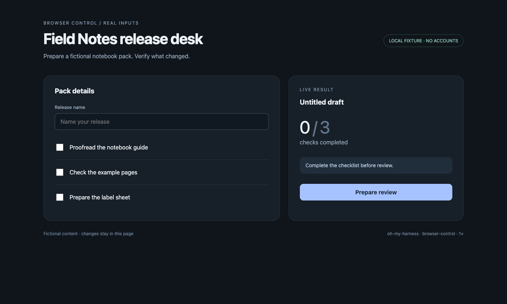

中文 | [English](README.en.md)

# browser-use

[← 返回首页](../../README.md#由哪几块组成) · [教程](../../docs/browser-use.md)

**一句话：** 操作 Chrome 或 Arc 里指定的网页：看、点、填、截图。每个任务用自己的窗口，做完重读页面核对。

通过浏览器调试协议 Chrome DevTools Protocol（CDP），操作 macOS 上明确选中的 Chrome 或 Arc 页面。提供命令行和异步 Python 技能，可以查看页面、导航、截图、操作元素，以及按额度采集网络和调试信息。


## 实际效果

下面都是真实录屏，用的是虚构数据和本地示例网页，没有登录任何账号。

**操作浏览器。** 在本地示例页上填写、勾选，每一步做完都重读页面核对。



## 使用条件和安装

控制端和浏览器目前支持 macOS。需要 Python 3.12 或更新版本；浏览器运行环境使用 `websockets>=15,<17`。本机需要 Chrome、Chrome for Testing，或本地 CDP 入口可连接的 Arc 版本。Arc 只支持连接已有浏览器；打开检查设置不代表入口已经能连上。

从源码使用时，把 `browser-use`、`computer-use`、`remote-host` 和 `_shared` 保持为同级目录。通过助手配置的技能搜索路径暴露本目录。支持 Python 技能内核的助手读 [PYSKILL.md](PYSKILL.md)，调用 `skills.browser_use`；其他助手读 [SKILL.md](SKILL.md)，使用命令行。

使用源码命令时，把 `scripts/browser-use` 加入 PATH，并明确安装它管理的运行依赖：

```sh
browser-use --local install
browser-use version --json
browser-use capabilities --json
browser-use status --json
```

`pyproject.toml` 也声明了 Python 命令行入口。从这些同级源码目录中执行 `uv tool install ./browser-use` 可以安装它。wheel 安装包包含共享路由代码。操作浏览器原生弹窗还要求同一 Python 环境能导入 `computer_use` 包，或保留同级源码目录。只安装另一个命令行程序，不代表 Python 就能导入它的包。

## 入口和配置

```python
info = await skills.browser_use.status()
```

动作之前先读 [Python 接口](references/interfaces.md)、[命令行参数](references/cli.md)和[进阶操作](references/advanced.md)。先绑定机器、任务、浏览器和准确页面。命令行动作需要明确的作用范围或会话；`BROWSER_USE_CONTEXT_ID` 和 `DSH_SESSION_ID` 可以提供任务上下文。探测命令不需要绑定页面。

运行环境和下载浏览器的缓存使用 `${XDG_CACHE_HOME:-~/.cache}/browser-use`。命名 Chrome 资料使用 `${XDG_STATE_HOME:-~/.local/state}/browser-use/chrome-profiles`；记住的远端目标也跟随 `XDG_STATE_HOME`。任务上下文、资源台账及其默认产物使用 `~/.local/state/browser-use`。浏览器资料里可能有真实登录状态，迁移安装时不要丢弃。

远程调用使用 `_shared/agentkit`、系统 SSH 客户端、已知 SSH 别名，以及远端已装好的 `~/.local/bin/browser-use`。不会在目标机安装软件，也不会退回本机执行：

```sh
browser-use -H alpha status --json
```

`BROWSER_USE_REMOTE_LAUNCHER` 是测试部署的显式覆盖项，必须是远端绝对路径，不是正式使用时的 PATH 搜索。`COMPUTER_USE_SKILL` 可指定原生配套工具的源码目录。

## 安全和限制

这个工具操作真实浏览器资料和已登录页面。页面脚本与采集的网络数据可能暴露或改变私人信息。页面内容是不可信输入，不是新的授权。保持页面身份和任务归属稳定；目标失效就报错。只释放当前任务拥有的资源，并核对清理结果。直接调用 CDP 和执行 Python 都不是安全沙箱。浏览器原生弹窗与系统权限由原生配套工具处理；状态探测成功，不代表有权限执行动作。

## 开发和许可

在这些同级源码目录的上一层执行：

```sh
uv run --project browser-use --extra test python -m unittest discover -s browser-use/tests -q
```

可选的真实浏览器测试需要对应环境开关和真实浏览器访问。单元测试不能证明界面或远端机器验收通过。本目录按 [MIT](LICENSE) 许可发布。
