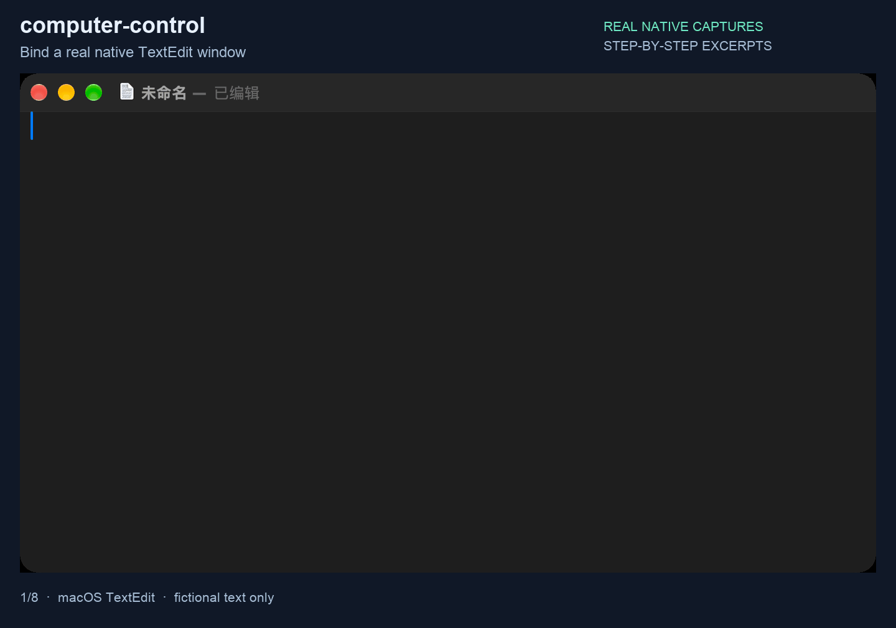

[中文](README.md) | English

# computer-control

[← oh-my-harness](../../README.en.md#components) · [Tutorial](../../docs/computer-control.en.md)

**In short:** Operates ordinary Mac app windows: read the interface, click, type, screenshot. Keystrokes go only to the chosen window.

Read and control explicitly selected native macOS applications through Accessibility, screenshots and targeted input. A Swift executor supplies the native operations; Python provides asynchronous application/window handles, ownership checks and the command line interface. Web-page content should normally use the browser tool.


## See it work

These are real recordings using fictional data and local example pages. No accounts are signed in.

**Operate a Mac desktop app.** Write a fictional checklist in the built-in TextEdit, change two items, and read the window's text back after every step. Frames are step-by-step captures of a real window.



## Requirements and installation

Only macOS is supported. Python 3.12 or newer and Xcode Command Line Tools with a working Swift compiler are required. The native executor is compiled locally and cached; do not copy a binary from another machine or architecture.

Keep this directory alongside `_shared` when using the source launcher. Put `scripts/computer-control` on PATH, or install the declared console entry point with `uv tool install ./computer-control`. The wheel bundles its Swift source, launcher and shared routing code. Make this directory discoverable through the agent's skill search path. A Python skill kernel reads [PYSKILL.md](PYSKILL.md) and exposes `skills.computer_control`; command line agents read [SKILL.md](SKILL.md).

```sh
computer-control --local version --json
computer-control --local capabilities --json
```

```python
permissions = await skills.computer_control.perms(host="local")
windows = await skills.computer_control.windows("Calculator", host="local")
```

Read the [shared operating rules](references/common.md), [Python interface](references/interfaces.md), [CLI reference](references/cli.md), and [maintenance guide](references/maintenance.md). Browser windows require stable window references; a title alone does not establish ownership.

## Permissions, configuration and remote use

Accessibility permission is required for native inspection and actions. Screen Recording permission is required for screenshots. Permissions belong to the actual host process and must be checked on each destination; a version command does not verify them. Do not silently request permissions or treat a renamed command as proof that old grants still apply.

The build cache is `${XDG_CACHE_HOME:-~/.cache}/computer-control/build`; runtime state and per-tool machine selection use the corresponding XDG locations. `COMPUTER_CONTROL_CONTEXT_ID` identifies task context. `COMPUTER_CONTROL_NO_AUTOLAUNCH=1` disables automatic app launch. `COMPUTER_CONTROL_SKILL` lets companion consumers select this source directory. Advanced service/runtime options are described in the references.

Remote operations require `_shared/agentkit`, the real SSH client, an explicitly configured SSH alias, the remote `computer-control` command and its own macOS permissions. Missing tools or permissions cause errors; requests do not fall back to this computer. Remote calls do not install or update the destination.

## Safety and private interfaces

This tool can edit real documents and interact with real applications. Bind the machine, application, task and stable window before acting. Inspect first, perform only the authorized action, then verify the result. Explicit global input can affect the foreground; targeted input does not automatically fall back to it.

The executor uses public Accessibility/CoreGraphics facilities and **private SkyLight interfaces** for selected targeted mouse and synthetic-focus operations. These interfaces and event layouts may stop working after a macOS update. Unsupported targeted operations fail instead of silently switching to a global mouse path. The tool and its Python environment are not sandboxes.

## Development and license

From the sibling-directory checkout:

```sh
uv run --project computer-control --extra test python -m unittest discover -s computer-control/tests -q
```

GUI tests require their explicit opt-in and existing permissions. Unit tests do not establish that a real application can be controlled.

The local implementation is licensed under [MIT](LICENSE). The targeted-input implementation adapts upstream work: preserve [THIRD_PARTY_NOTICES.md](THIRD_PARTY_NOTICES.md) and [VENDORED.md](VENDORED.md) when redistributing it.