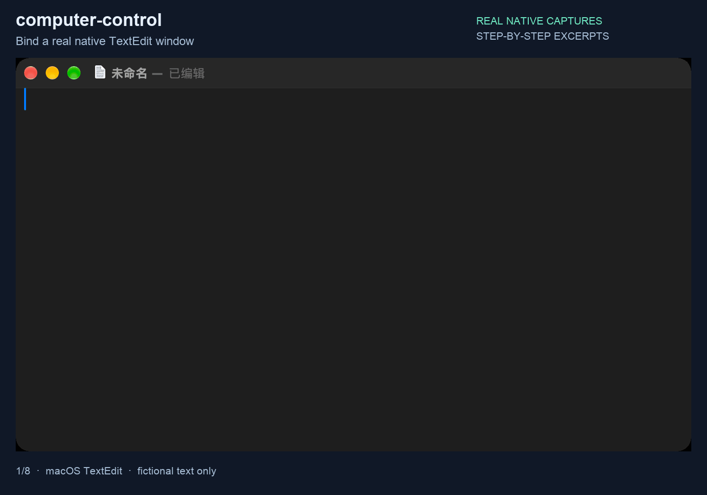

中文 | [English](README.en.md)

# computer-control

[← 返回首页](../../README.md#由哪几块组成) · [教程](../../docs/computer-control.md)

**一句话：** 操作 Mac 上的普通应用窗口：读界面、点按钮、打字、截图，输入只发给指定的那个窗口。

通过辅助功能、截图和定向输入，读取和操作明确选中的 macOS 原生应用。Swift 执行程序负责系统操作；Python 提供异步应用和窗口对象、归属检查及命令行接口。网页内容通常应使用浏览器工具。


## 实际效果

下面都是真实录屏，用的是虚构数据和本地示例网页，没有登录任何账号。

**操作 Mac 桌面应用。** 在系统自带的文本编辑里写一份虚构清单，再改两项；每一步都把窗口里的文字读回来核对。画面是真实窗口的分步截图。



## 使用条件和安装

只支持 macOS。需要 Python 3.12 或更新版本，以及带有可用 Swift 编译器的 Xcode Command Line Tools。原生执行程序会在本机编译并缓存；不要从另一台机器或不同架构复制二进制程序。

使用源码启动器时，把本目录与 `_shared` 放在同一层。把 `scripts/computer-control` 加入 PATH，或用 `uv tool install ./computer-control` 安装已声明的命令行入口。wheel 安装包带有 Swift 源码、启动器和共享路由代码。把本目录放进助手可发现的技能搜索路径。支持 Python 技能内核的助手读 [PYSKILL.md](PYSKILL.md)，通过 `skills.computer_control` 使用；命令行助手读 [SKILL.md](SKILL.md)。

```sh
computer-control --local version --json
computer-control --local capabilities --json
```

```python
permissions = await skills.computer_control.perms(host="local")
windows = await skills.computer_control.windows("Calculator", host="local")
```

先读[共用操作规则](references/common.md)、[Python 接口](references/interfaces.md)、[命令行参考](references/cli.md)和[维护指南](references/maintenance.md)。浏览器窗口需要稳定的窗口引用；只有标题不能证明窗口归属。

## 权限、配置和远程使用

原生界面读取与操作需要辅助功能权限。截图需要屏幕录制权限。权限属于实际执行的宿主进程，每台目标机都要检查；查版本不能证明权限可用。不要悄悄申请权限，也不能因为命令换名就认定旧授权仍有效。

编译缓存使用 `${XDG_CACHE_HOME:-~/.cache}/computer-control/build`；运行状态和本工具自己的机器选择使用对应的 XDG 目录。`COMPUTER_CONTROL_CONTEXT_ID` 标记任务上下文。`COMPUTER_CONTROL_NO_AUTOLAUNCH=1` 禁止自动启动应用。`COMPUTER_CONTROL_SKILL` 供使用方选择这个源码目录。进阶服务和运行选项见参考文档。

远程操作需要 `_shared/agentkit`、真实 SSH 客户端、明确配置的 SSH 别名、远端 `computer-control` 命令，以及远端自己的 macOS 权限。缺工具或权限就报错，不会退回这台电脑执行。远程调用不会安装或更新目标机。

## 安全和私有接口

这个工具可以修改真实文档、操作真实应用。动作前绑定机器、应用、任务和稳定窗口。先查看，只执行已授权动作，再核对结果。明确使用全局输入会影响前台应用；定向输入不会自动退回全局输入。

执行程序使用公开的 Accessibility 和 CoreGraphics 能力；部分定向鼠标与模拟焦点操作也使用 **SkyLight 私有接口**。这些接口和事件格式可能在 macOS 更新后失效。不支持的定向操作会报错，不会悄悄改用全局鼠标路径。工具及其 Python 环境都不是沙箱。

## 开发和许可

在这些同级源码目录的上一层执行：

```sh
uv run --project computer-control --extra test python -m unittest discover -s computer-control/tests -q
```

界面测试需要明确启用，并已有相应权限。单元测试不能证明真实应用一定可控。

本地实现按 [MIT](LICENSE) 许可发布。定向输入实现改编自上游工作；再分发时保留 [THIRD_PARTY_NOTICES.md](THIRD_PARTY_NOTICES.md) 和 [VENDORED.md](VENDORED.md)。
