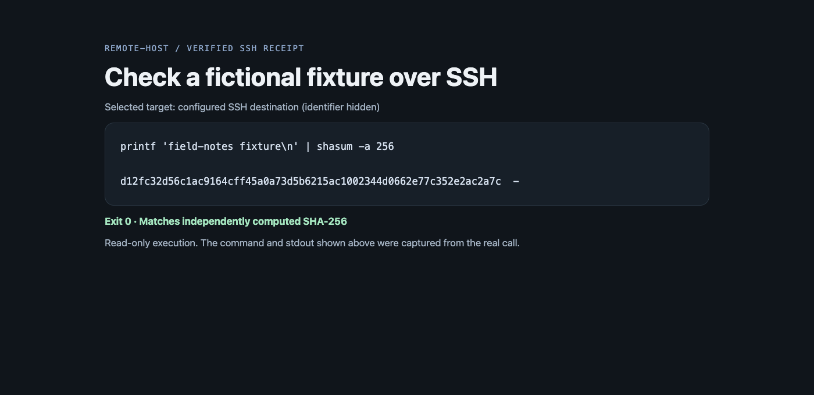

中文 | [English](README.en.md)

# remote-host

[← 返回首页](../../README.md#由哪几块组成) · [教程](../../docs/remote-host.md)

**一句话：** 通过 SSH 在另一台机器上执行命令、传文件、跑后台任务。对面缺工具就直接报错，不会悄悄改在本机执行。

通过系统 SSH 客户端执行明确指定的内容，查看已配置的主机，传输并校验文件，管理远端任务、应用命令和截图。异步 Python 技能和命令行使用同样的目标选择与传输行为。


## 实际效果

下面都是真实录屏，用的是虚构数据和本地示例网页，没有登录任何账号。

**远程执行回执。** 通过 SSH 跑一条只读命令，结果经过独立核对。



## 使用条件和安装

调用端支持 macOS，需要 Python 3.10 或更新版本和系统 SSH 工具。Unix SSH 目标装有所需解释器和实用程序后，支持完整的相应命令集。Windows SSH 目标只有限支持明确的 PowerShell 内容执行，不提供 Windows 桌面或浏览器控制。

从源码使用时，把本目录与 `_shared` 放在同一层，将 `scripts/remote-host` 加入 PATH。也可以用 `uv tool install ./remote-host` 安装命令行入口；wheel 安装包带有共享库。通过助手配置的技能搜索路径暴露本目录。支持 Python 技能内核的助手读 [PYSKILL.md](PYSKILL.md)，使用 `skills.remote_host`；其他助手读 [SKILL.md](SKILL.md)。

```sh
remote-host hosts
remote-host -H alpha run 'uname -a'
```

```python
result = await skills.remote_host.run("uname -a", host="alpha", quiet=True)
```

`alpha` 是示例 SSH 别名，不是内置机器。在自己的 SSH 配置中登记真实目标。主机列表使用原有文本输出，没有 `hosts --json` 接口。

## 配置和远程行为

认证、用户、端口、地址类型和跳转均跟随系统 SSH 配置。工具不内置私人机器清单。记住的主机、解释器和工作目录保存在 `${XDG_STATE_HOME:-~/.local/state}/remote-host` 下、本工具自己的 `pin.json` 中。一个工具选机器，不会替另一个工具选。

可选的网络标签从 `${XDG_CONFIG_HOME:-~/.config}/remote-host/networks.json` 读取。这是把 CIDR 网段对应到说明文字的 JSON 对象。没有文件时，诊断直接使用不带标签的地址。例如：

```json
{"192.0.2.0/24": "example network"}
```

`REMOTE_HOST_PROXY=host:port` 覆盖子进程的代理地址。直接借用代理时，目标机需要能连接调用端机器。`reverse_proxy` 则向明确选定的别名建立私有、临时的 SSH 转发连接；远端需要相应的 `sh` 和 `lsof` 支持。它不改用户的 SSH 配置，也不启动代理服务。详见[主机和代理行为](references/hosts-and-proxy.md)与[命令行参考](references/cli.md)。

SSH 目标必须已经装好所需命令或解释器。原生桌面和浏览器功能还要求目标端具备相应工具及 `_shared` 支持。缺命令就失败；不退回本机，也不自动安装工具。

## 安全和开发

执行内容使用认证用户的真实权限。这不是沙箱。改文件前先读清解析后的路径，保留符号链接的目标，并核对传输内容。修改操作超时后，在核对前结果仍不明确，不要盲目重放。桌面截图和命令输出可能含私人数据。认证提示和权限变更需要用户明确操作。

在这些同级源码目录的上一层执行：

```sh
uv run --project remote-host python -m unittest discover -s remote-host/tests -q
```

测试使用隔离数据，不能证明某个用户的 SSH 目标可连接。本目录按 [MIT](LICENSE) 许可发布。
